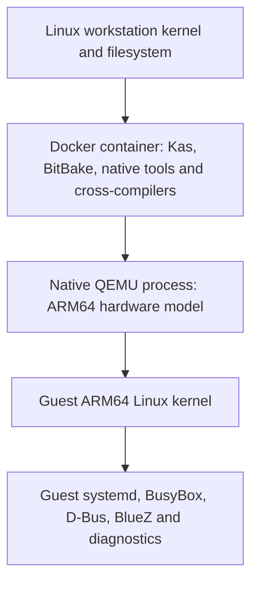
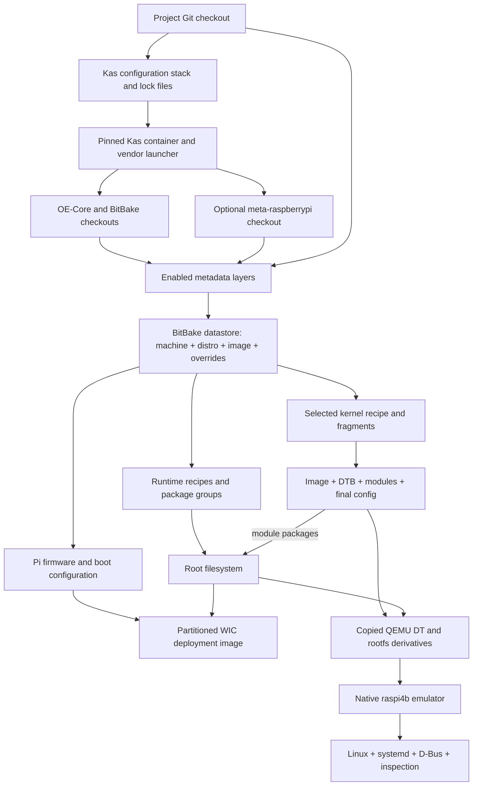

# G1 Architecture and Practical Guide

**QuantumTooth — an embedded Linux work class**

**Prevalidation snapshot used by Chapters 1–17:** `0e6a450e3cf74bce12871efb053c42f057782d62`

**Guide dates:** prevalidation 2026-11-09; physical closeout 2026-11-23

This manual is for an experienced embedded engineer who has not previously used embedded Linux, Yocto, OpenEmbedded, BitBake, or Kas. It assumes you understand a cross-compiler, interrupts, RAM versus nonvolatile storage, and board bring-up. It does **not** assume that you know Linux boot, distribution construction, package managers, device trees, or Linux administration.

The objective is to understand and recreate the system manually. The repository's convenience scripts are explained, but the main work class also shows the operations they automate: creating metadata, resolving sources, generating configuration, invoking BitBake, inspecting packages, preparing an emulated disk/device tree, booting, and measuring.

**Completion boundary:** physical G1 is accepted under the operator's explicit
supply-current assumption, disclosed in the [final physical lab](#final-physical-lab).
Four physical image variants and twelve scheduling trials are verified.
The [G2 PQC-over-BLE demonstration](G2_Architecture_and_Practical_Guide.md) is now
complete; G3 FPGA feasibility is next, followed by G4/G5 physical recovery validation.
Chapters 1–17 preserve the earlier teaching snapshot and its historical QEMU
results; their code inventories/package counts are not the current release bill
of materials. Lab 17 is the current deployment and G1 verification procedure.

The authorities are [openspec/DESIGN.md](../../openspec/DESIGN.md), particularly SCOPE, BASE-1..3 and G1, and [openspec/HARDWARE.md](../../openspec/HARDWARE.md), particularly HW-1..4. This guide explains their implementation; it does not replace or revise them.

## Reading and laboratory map

1. [From firmware engineering to embedded Linux](#linux-foundations)
2. [The technologies and the jobs they perform](#technologies)
3. [Complete repository inventory](#inventory)
4. [Macro architecture and design rationale](#architecture)
5. [Kas configuration and locking](#kas)
6. [Layers, distribution policy, images, packages and services](#images)
7. [Kernel configuration and PREEMPT_RT](#kernel)
8. [Firmware, device trees, root filesystems and disk images](#boot)
9. [The exact build and evidence flow](#build-flow)
10. [Practical work class: recreate the metadata and build manually](#manual-labs)
11. [Practical work class: prepare and boot the Pi artifacts manually](#manual-boot)
12. [Practical work class: measure and understand the diagnostics](#measurement-labs)
13. [Using and understanding the automation](#automation)
14. [Measured implementation results and retained failures](#results)
15. [Physical G1 boundary](#physical-g1)
16. [Troubleshooting, maintenance and review questions](#troubleshooting)
17. [Glossary and primary references](#references)
18. [Final lab: physical deployment and G1 acceptance](#final-physical-lab)

### Three learning outcomes

At the end, you should be able to:

1. Explain how a board selection, operating-system policy, kernel configuration and package selection become an identifiable bootable Linux system.
2. Reconstruct the project metadata and execute its build/boot operations without depending on the high-level project wrappers.
3. Prove which kernel and root filesystem ran, collect an attributable RT/non-RT comparison, and explain the limits of physical platform acceptance and later feature gates.

### Where commands execute

Every laboratory distinguishes these contexts:

| Label | What it means | Typical paths |
|---|---|---|
| **HOST** | Your normal Linux workstation terminal, outside Docker | repository-relative `build/…` |
| **CONTAINER** | A shell entered through the pinned Kas container; it is still using the host Linux kernel | `/repo`, `/work`, `/build`, `/downloads`, `/sstate` |
| **GUEST** | A terminal inside the ARM64 Linux system running under QEMU | `/proc`, `/sys`, `/etc`, `/run` of the emulated machine |

A path such as `/build/tmp/deploy/images/raspberrypi4-64/` belongs to a particular selected container mount. On the host it is `build/raspberrypi4-64-<profile>-<image>/tmp/deploy/images/raspberrypi4-64/`. Do not paste container absolute paths into a host shell and expect them to exist.

Prediction and explain-back questions are optional learning aids. Build, identity, hash and service checks are engineering acceptance checks; answering a quiz is not an acceptance condition.

<a id="linux-foundations"></a>
## 1. From firmware engineering to embedded Linux

### 1.1 Why one firmware binary becomes several artifacts

A small MCU application often combines startup, drivers, scheduler and application logic into one linked firmware image. A Linux system separates those responsibilities:

| Familiar embedded responsibility | Linux counterpart in this project |
|---|---|
| Reset/startup and board boot configuration | Pi boot ROM/EEPROM and firmware, or QEMU's direct loader during emulation |
| Scheduler, memory protection, interrupt handling and hardware drivers | The Linux kernel |
| Board addresses, interrupts, clocks and device connections | Device tree plus relevant drivers and firmware |
| Files and applications resident in flash/storage | A root filesystem containing executables, libraries, configuration and device-management policy |
| Startup task creation | PID 1, here systemd, starting services according to dependencies and conditions |
| Reusable application support | Shared libraries such as glibc and OpenSSL libcrypto |
| Background communication stack | D-Bus and BlueZ services |
| Firmware build description | Yocto/OpenEmbedded recipes and configuration, executed by BitBake and arranged by Kas |

The result is therefore more than `Image`. A kernel can start and then fail because it cannot find its root filesystem. A root filesystem can contain Bluetooth userspace while lacking the required controller driver or firmware. A driver can be compiled as a module but never installed in the image. These are separate failures, and this repository has explicit checks for them.

### 1.2 Kernel space and user space

The **kernel** runs privileged code. It implements scheduling, virtual memory, filesystem access, driver APIs and system calls. An application normally does not manipulate a hardware register directly; it requests a kernel operation through a system call or a driver interface.

**User space** consists of processes outside the kernel: shells, systemd, D-Bus, Bluetooth services and future QuantumTooth applications. Processes have separate virtual address spaces. A faulty ordinary userspace process is not automatically a whole-kernel failure.

A kernel **module** is separately loadable kernel code, commonly a `.ko` file. It is not an ordinary userspace executable. Its ABI and configuration must match its kernel. In this project, `modinfo -F vermagic hci_uart` provides useful release/preemption identity evidence; merely finding a file named `hci_uart.ko` is weaker evidence.

### 1.3 What a root filesystem is

The root filesystem is the directory tree visible at `/` after the kernel mounts its root device. Relevant directories include:

| Directory | Meaning in a running guest |
|---|---|
| `/etc` | Persistent system configuration, account data, service overrides |
| `/usr/bin`, `/usr/sbin`, `/usr/libexec` | Executable programs; a daemon may live outside the interactive shell's PATH |
| `/usr/lib` | Shared libraries, firmware/module locations under the distribution's layout, systemd units |
| `/lib`, `/bin`, `/sbin` | Compatibility paths affected by `usrmerge`; do not assume they are independent storage trees |
| `/dev` | Device nodes such as the serial console and SD block device |
| `/proc` | A virtual kernel interface for running state; examples are `/proc/1/comm`, `/proc/meminfo` and `/proc/config.gz` |
| `/sys` | A virtual interface exposing devices, driver state and kernel attributes |
| `/run` | Volatile runtime data; uploaded experiment scripts and results live here in disposable guests |
| `/boot` | A conventional mount point for boot files; the Pi deployment disk also has a separate FAT boot partition |

`/proc` and `/sys` are not ordinary files copied out of Git. Their contents are produced by the running kernel. That is why inspecting `/proc/config.gz` tells us something about the booted kernel that a source fragment alone cannot prove.

### 1.4 Processes, PID 1 and services

A **process** is a running program. A **thread** is an execution context inside a process. The kernel schedules threads. The first userspace process has process ID 1; this project selects **systemd** for that role.

A systemd **unit** describes something systemd manages. A service unit usually starts a background process, called a **daemon**. A getty service opens a terminal login session. Units can have dependencies and conditions.

These commands answer different questions:

```sh
# GUEST — identify PID 1 and examine services.
cat /proc/1/comm
systemctl is-active dbus
systemctl --failed --no-pager
systemctl show bluetooth hciuart -p ActiveState -p ConditionResult -p Result
```

Expected here: `systemd`, active D-Bus and no failed units. Bluetooth-related units can be inactive because their hardware conditions are false in emulation. A condition skip with `Result=success` is different from a daemon failing after startup. Neither proves a physical radio works.

### 1.5 BusyBox, glibc, D-Bus, BlueZ and OpenSSL

- **BusyBox** provides many small Unix utilities, often as applets of one binary. A familiar desktop command or option may be absent. For example, `head -1` was not supported in the tested base image; use the documented form or invoke `busybox` to inspect its banner/applets.
- **glibc** is the GNU C library. Most userspace programs depend on a C library for system-call wrappers and standard runtime functions. Selecting glibc is a distribution/toolchain decision, not an application added with a shell script.
- **D-Bus** is local inter-process communication. BlueZ exposes APIs over the system bus. D-Bus being active does not imply an attached Bluetooth controller.
- **BlueZ** is the Linux Bluetooth userspace stack. `bluetoothd` is its daemon. HCI is the host/controller interface below the higher-level BLE application APIs.
- **OpenSSL libcrypto** provides cryptographic functions as a shared library. Installing that library does not require installing the `openssl` command-line program. Future application crypto work is outside this implementation.

The current platform contains these foundations. It does not yet contain the future `qtooth-ble` or `qtooth-hwe2dr` applications.

### 1.6 Device tree is hardware description, not a driver

A device tree describes devices and their resources: compatible strings, addresses, interrupt routes, clocks, pin configuration and whether a device is enabled. Its source is generally a `.dts` with included `.dtsi` files. The device-tree compiler creates a `.dtb` binary. An overlay is commonly compiled to `.dtbo` and describes changes to a base tree.

A matching kernel driver uses that description to bind to a device, as explained in the kernel's [device-tree usage model](https://docs.kernel.org/devicetree/usage-model.html). Changing a device-tree node does not create an implementation of missing hardware in QEMU. Installing a driver does not prove a header pin is configured, wired or electrically correct.

The repository preserves the deployment Pi DTB and adapts a **copy** for QEMU's modeled SD and serial interfaces. That distinction is central to the later labs.

### 1.7 Linux real-time behavior

Normal Linux already has priorities, preemption and interrupt threads in some drivers. The Pi non-RT reference here has `CONFIG_PREEMPT=y`: it is not a claim of “no preemption.”

**PREEMPT_RT** changes kernel locking and interrupt execution so more work is preemptible and scheduler-managed. Priority inheritance can temporarily raise the priority of a lock owner blocking a higher-priority task. This reduces some sources of unbounded priority inversion; it does not make all code preemptible or give radio delivery a hard deadline.

`SCHED_FIFO` is a userspace scheduling policy. A FIFO-80 test thread can be created on either kernel profile. Its existence does not by itself prove `CONFIG_PREEMPT_RT=y`. Conversely, an RT configuration does not prove any particular latency bound. This guide verifies configuration and measured behavior separately.

<a id="technologies"></a>
## 2. The technologies and the jobs they perform

### 2.1 Yocto Project, OpenEmbedded and BitBake

**Yocto Project** provides a framework, tools, reference practices and release ecosystem for constructing custom Linux systems. It is not a prebuilt distribution that you install onto the Pi with a desktop package installer.

**OpenEmbedded-Core**, abbreviated OE-Core, supplies core build metadata: recipes for software, reusable classes, machine definitions, toolchain support and image machinery. The repository pins OE-Core's Wrynose 6.0 metadata. It does not clone a complete Poky checkout; the separate OE-Core and BitBake repositories provide the pieces used here.

**BitBake** is the task/dependency execution engine. It parses configuration and recipes, constructs a dependency graph, computes task signatures, then runs or restores the tasks needed by a requested target.

A **recipe**, usually `.bb`, describes how to obtain, configure, build, install and package something. A **class**, `.bbclass`, supplies reusable behavior. A **recipe append**, `.bbappend`, extends a matching upstream recipe without copying that whole recipe into the project.

An image recipe is itself a BitBake target, but its job is to assemble a filesystem and deployment artifacts rather than just compile one application.

### 2.2 What a layer is

A **layer** is a collection of metadata, normally with `conf/layer.conf`. It is a source-organization and integration boundary. It is not a runtime execution layer inside the kernel.

In this repository:

- OE-Core's `meta` layer supplies the operating-system/toolchain foundation.
- `meta-raspberrypi` supplies board-specific metadata and firmware/kernel integration for Pi builds.
- `layers/meta-qtooth-platform` supplies QuantumTooth's platform policy and extensions.
- `layers/meta-qtooth-ble` and `layers/meta-qtooth-hwe2dr` are currently placeholders, not registered buildable layers.

### 2.3 Machine, distribution, image and profile

These selections answer different questions:

| Concept | Question answered | Actual example |
|---|---|---|
| Machine | Which target hardware and BSP rules? | `raspberrypi4-64`, or the generic `qemuarm64` reference |
| Distribution | Which shared OS policy? | `qtooth`: glibc, systemd, features and package format |
| Image | Which target packages and filesystem outputs? | `qtooth-image-base` or `qtooth-image-diagnostic` |
| Kernel profile | Which project kernel configuration variant? | `QTOOTH_KERNEL_PROFILE = "nonrt"` or `"rt"` |
| Build configuration | Which combination of these inputs and repositories? | A composed set of Kas YAML files |

`profile` is a project convention implemented through Kas configuration and a variable used by kernel appends. It is not an additional independent Linux kernel provider.

### 2.4 Kas

**Kas** reads YAML configuration, obtains the specified repositories, selects layers and target settings, generates the BitBake build configuration and starts BitBake or a configured shell.

Kas is not a compiler. It arranges the sources and environment in which BitBake operates. Its lockfiles pin repository commits; individual recipes pin the software sources those repositories describe.

The project adds a small selector/parser and uses the official, vendored Kas 5.5 container wrapper. You do not need a separately installed host `kas` Python package for the documented build route.

### 2.5 Docker and QEMU solve different problems

**Docker** gives the build tools a controlled userspace environment. Container processes still use the host Linux kernel. A container does not make host filesystem, scheduling, memory or WSL2 behavior disappear.

**QEMU** implements virtual hardware on which the ARM64 target kernel runs. Here it uses software translation, called **TCG**, rather than host KVM acceleration. The guest has its own kernel and userspace.



The cross-compiler runs inside the build container and produces ARM64 code. Native `qemu-system-aarch64`, `debugfs`, `fdtget` and `modinfo` run on the build host architecture inside the container. The target image does not need to contain these native build tools.

### 2.6 Caches and evidence

A download cache avoids fetching the same source again. A **shared-state cache**, or sstate, holds reusable results of selected BitBake tasks. A task signature identifies its inputs; **hash equivalence** can recognize equivalent results and improve reuse. These caches are different from the target root filesystem.

An evidence record is also different from a cache. `artifacts.json`, final `.config`, manifests, logs and runtime captures answer “what actually built and booted?” Keep them even when a failed run leads to a corrected rerun.

<a id="inventory"></a>
## 3. Complete repository inventory

This inventory covers all **80 tracked files** in the examined project snapshot, including hidden project configuration and placeholders. The guide itself is a new documentation artifact. Git internals are not build metadata. Ignored third-party checkouts and generated build/cache trees can contain many thousands of files; their important entry points are mapped separately rather than treating generated objects as project-owned source.

### 3.1 Every tracked file and its job

| File | Function |
|---|---|
| `.agents/skills/.openspec-target` | Selects Codex as the local OpenSpec agent integration; no target-image effect. |
| `.agents/skills/openspec-apply-change/SKILL.md` | Local apply-change workflow instructions for agent-assisted OpenSpec work; not a Linux build dependency. |
| `.agents/skills/openspec-archive-change/SKILL.md` | Local archive-change workflow instructions for agent-assisted OpenSpec work; not a Linux build dependency. |
| `.agents/skills/openspec-explore/SKILL.md` | Local explore workflow instructions for agent-assisted OpenSpec work; not a Linux build dependency. |
| `.agents/skills/openspec-propose/SKILL.md` | Local propose workflow instructions for agent-assisted OpenSpec work; not a Linux build dependency. |
| `.agents/skills/openspec-sync-specs/SKILL.md` | Local sync-specs workflow instructions for agent-assisted OpenSpec work; not a Linux build dependency. |
| `.agents/skills/openspec-update-change/SKILL.md` | Local update-change workflow instructions for agent-assisted OpenSpec work; not a Linux build dependency. |
| `.gitattributes` | Configures Git LFS tracking for the five rendered SVG diagrams. LFS pointers need checkout materialization for viewing; this does not affect BitBake. |
| `.gitignore` | Keeps build/, upstream/, cache/ and local generated output out of source control. |
| `LICENSE` | Project MIT license; upstream recipes retain their own licenses and checksums. |
| `README.md` | Project entry point, current status and links to authoritative design and build instructions. |
| `SHOPPING_LIST.md` | Procurement planning and hardware purchase references; no build-system effect and no proof of bench qualification. |
| `components/ble/.gitkeep` | Tracked empty-directory placeholder. No recipe, application, build task or runtime implementation. |
| `components/hwe2dr/.gitkeep` | Tracked empty-directory placeholder. No recipe, application, build task or runtime implementation. |
| Historical `bootstrap-verification.md` (retired) | Generic bootstrap provenance and checks; consolidated in Chapters 10 and 14. |
| Historical `pi4-rt-prevalidation.md` (retired) | Four-image QEMU comparison, failures and regression; consolidated in Chapter 14. |
| Historical `pi4-rt-qemu.md` (retired) | Pi emulation reproduction; consolidated in Chapters 11–13. |
| Historical `qemu-nonrt.md` (retired) | Generic ARM64 reproduction; consolidated in Chapters 10 and 13. |
| `docs/diagrams/ble.puml` | PlantUML source for the ble design view. Depicts architectural intent including future work; protected documentation, not build input. |
| `docs/diagrams/ble.svg` | Rendered Git-LFS SVG for the ble design view. Depicts architectural intent including future work; protected documentation, not build input. |
| `docs/diagrams/hardware.puml` | PlantUML source for the hardware design view. Depicts architectural intent including future work; protected documentation, not build input. |
| `docs/diagrams/hardware.svg` | Rendered Git-LFS SVG for the hardware design view. Depicts architectural intent including future work; protected documentation, not build input. |
| `docs/diagrams/hwe-runtime.puml` | PlantUML source for the hwe-runtime design view. Depicts architectural intent including future work; protected documentation, not build input. |
| `docs/diagrams/hwe-runtime.svg` | Rendered Git-LFS SVG for the hwe-runtime design view. Depicts architectural intent including future work; protected documentation, not build input. |
| `docs/diagrams/hwe-training.puml` | PlantUML source for the hwe-training design view. Depicts architectural intent including future work; protected documentation, not build input. |
| `docs/diagrams/hwe-training.svg` | Rendered Git-LFS SVG for the hwe-training design view. Depicts architectural intent including future work; protected documentation, not build input. |
| `docs/diagrams/platform.puml` | PlantUML source for the platform design view. Depicts architectural intent including future work; protected documentation, not build input. |
| `docs/diagrams/platform.svg` | Rendered Git-LFS SVG for the platform design view. Depicts architectural intent including future work; protected documentation, not build input. |
| `docs/experiments/.gitkeep` | Tracked empty-directory placeholder. No recipe, application, build task or runtime implementation. |
| `kas/base.lock.yml` | Sibling lock overriding OE-Core and BitBake branches with exact commits. |
| `kas/base.yml` | Shared Kas schema, distro, base image target, OE-Core and BitBake repositories, project layer and build parallelism. |
| `kas/images/diagnostic.yml` | Selects qtooth-image-diagnostic independently of the kernel profile. |
| `kas/machines/qemuarm64.yml` | Generic ARM64 development machine; includes base/non-RT and enables machine-scoped serial autologin, ext4 and SLIRP. |
| `kas/machines/raspberrypi4-64.lock.yml` | Exact matching meta-raspberrypi commit, loaded alongside the Pi configuration. |
| `kas/machines/raspberrypi4-64.yml` | Pi machine and BSP repository; fixes kernel provider, deployment formats, headless graphics and physical Bluetooth UART policy. |
| `kas/profiles/nonrt.yml` | Default linux-yocto preference and ordinary-preemption profile selector; the Pi machine overrides the provider. |
| `kas/profiles/rt.yml` | Changes only QTOOTH_KERNEL_PROFILE to rt; reuses the same Pi kernel source and BSP. |
| `layers/meta-qtooth-ble/.gitkeep` | Tracked empty-directory placeholder. No recipe, application, build task or runtime implementation. |
| `layers/meta-qtooth-hwe2dr/.gitkeep` | Tracked empty-directory placeholder. No recipe, application, build task or runtime implementation. |
| `layers/meta-qtooth-platform/conf/distro/qtooth.conf` | Shared glibc/systemd, headless service/package policy and BlueZ feature selection. |
| `layers/meta-qtooth-platform/conf/layer.conf` | Registers the custom layer, recipe globs, dependency, release compatibility and conditional mask for the optional BSP append. |
| `layers/meta-qtooth-platform/recipes-bsp/.gitkeep` | Tracked empty-directory placeholder. No recipe, application, build task or runtime implementation. |
| `layers/meta-qtooth-platform/recipes-connectivity/bluez5/bluez5_5.86.bbappend` | Extends pinned BlueZ: Pi initialization commands retained, other tools trimmed, generic empty directory cleaned. |
| `layers/meta-qtooth-platform/recipes-core/images/qtooth-image-base.bb` | Assembles the minimal runtime through two package groups; adds native inspection tools as Pi build dependencies. |
| `layers/meta-qtooth-platform/recipes-core/images/qtooth-image-diagnostic.bb` | Requires the base image, restricts compatibility to Pi and adds finite measurement tools. |
| `layers/meta-qtooth-platform/recipes-core/packagegroups/packagegroup-qtooth-base.bb` | Defines mandatory runtime packages and explicit Pi driver/firmware dependencies; machine-specific package architecture. |
| `layers/meta-qtooth-platform/recipes-kernel/linux/linux-raspberrypi/inspect.cfg` | Shared Pi config visibility/high-resolution timers and narrowly disabled debug features. |
| `layers/meta-qtooth-platform/recipes-kernel/linux/linux-raspberrypi/nonrt.cfg` | Fixed ordinary preemption with integrated PREEMPT_RT disabled. |
| `layers/meta-qtooth-platform/recipes-kernel/linux/linux-raspberrypi/rt.cfg` | Fixed preemption with integrated PREEMPT_RT enabled. |
| `layers/meta-qtooth-platform/recipes-kernel/linux/linux-raspberrypi_6.18.bbappend` | Adds shared inspection plus selected profile fragments; deploys the final kernel configuration/release and source/configuration audit. |
| `layers/meta-qtooth-platform/recipes-kernel/linux/linux-yocto/nonrt.cfg` | Generic non-RT and running-config inspection settings; trims selected debug facilities while retaining boot logs. |
| `layers/meta-qtooth-platform/recipes-kernel/linux/linux-yocto_6.18.bbappend` | Applies the QEMU non-RT fragment and removes the late ttyprintk feature that otherwise overrides it. |
| `openspec/DESIGN.md` | Architecture source of truth: BASE/BLE/HWE requirements and G1–G5 gates. Includes future components, not all implemented. |
| `openspec/HARDWARE.md` | Hardware source of truth: physical parts, wiring and unresolved qualification. Build results cannot replace this authority. |
| `openspec/changes/archive/.gitkeep` | Tracked empty-directory placeholder. No recipe, application, build task or runtime implementation. |
| `openspec/changes/archive/2026-11-08-bootstrap-qtooth-platform/.openspec.yaml` | Historical 2026-11-08-bootstrap-qtooth-platform: OpenSpec schema/creation metadata. Archived planning evidence, not executable build metadata. |
| `openspec/changes/archive/2026-11-08-bootstrap-qtooth-platform/design.md` | Historical 2026-11-08-bootstrap-qtooth-platform: implementation decisions and rationale. Archived planning evidence, not executable build metadata. |
| `openspec/changes/archive/2026-11-08-bootstrap-qtooth-platform/proposal.md` | Historical 2026-11-08-bootstrap-qtooth-platform: problem, scope and intended result. Archived planning evidence, not executable build metadata. |
| `openspec/changes/archive/2026-11-08-bootstrap-qtooth-platform/specs/platform-base-image/spec.md` | Historical 2026-11-08-bootstrap-qtooth-platform: archived capability delta used to update the main specification. Archived planning evidence, not executable build metadata. |
| `openspec/changes/archive/2026-11-08-bootstrap-qtooth-platform/tasks.md` | Historical 2026-11-08-bootstrap-qtooth-platform: completed implementation/check tasks. Archived planning evidence, not executable build metadata. |
| `openspec/changes/archive/2026-11-09-prevalidate-pi4-rt-platform/.openspec.yaml` | Historical 2026-11-09-prevalidate-pi4-rt-platform: OpenSpec schema/creation metadata. Archived planning evidence, not executable build metadata. |
| `openspec/changes/archive/2026-11-09-prevalidate-pi4-rt-platform/design.md` | Historical 2026-11-09-prevalidate-pi4-rt-platform: implementation decisions and rationale. Archived planning evidence, not executable build metadata. |
| `openspec/changes/archive/2026-11-09-prevalidate-pi4-rt-platform/proposal.md` | Historical 2026-11-09-prevalidate-pi4-rt-platform: problem, scope and intended result. Archived planning evidence, not executable build metadata. |
| `openspec/changes/archive/2026-11-09-prevalidate-pi4-rt-platform/specs/platform-rt-prevalidation/spec.md` | Historical 2026-11-09-prevalidate-pi4-rt-platform: archived capability delta used to update the main specification. Archived planning evidence, not executable build metadata. |
| `openspec/changes/archive/2026-11-09-prevalidate-pi4-rt-platform/tasks.md` | Historical 2026-11-09-prevalidate-pi4-rt-platform: completed implementation/check tasks. Archived planning evidence, not executable build metadata. |
| `openspec/config.yaml` | OpenSpec planning context/schema and artifact rules; not parsed by Kas or BitBake. |
| `openspec/specs/.gitkeep` | Tracked empty-directory placeholder. No recipe, application, build task or runtime implementation. |
| `openspec/specs/platform-base-image/spec.md` | Current normative bootstrap behavior, six requirements/seven scenarios. |
| `openspec/specs/platform-rt-prevalidation/spec.md` | Current normative Pi emulation prevalidation behavior, seven requirements/nine scenarios. |
| `tools/build` | Resolves/parses or builds the selected image, saves recipe environments and invokes evidence collection. |
| `tools/build-selection` | Sourced Bash selector: validates five supported combinations, returns Kas stack/target/build directory and forwards remaining arguments. |
| `tools/build-tool.env` | Pinned official Kas version/commit, vendor wrapper checksum and container digest. |
| `tools/collect-build-evidence` | Freezes exact image/kernel/DT/native-emulator paths and hashes, manifests, final configuration, provenance and runtime-support audits. |
| `tools/kas` | Checks wrapper checksum and Linux Docker engine; sets isolated selection paths/shared caches and calls the vendor launcher. |
| `tools/pi-qemu-capture` | Host PTY capture, serial script upload, host sampling, framed result extraction and trial outcome recording. |
| `tools/pi4-guest-inspect` | Guest identity/service/configuration inspection and bounded smoke/idle/load trials; used over serial, not installed in the image. |
| `tools/run-pi-qemu` | Creates copied serial-login/DT/SD derivatives, records transformations, relays serial, enforces deadlines and rechecks source hashes. |
| `tools/run-qemu` | Dispatches generic runqemu or Pi native direct boot; uses frozen evidence rather than selecting the newest artifact. |
| `tools/summarize-pi-evidence` | Reads saved image/capture evidence and computes size/RAM/boot/latency summaries while retaining incomplete attempts. |
| `tools/vendor/kas-container` | Unmodified official Kas container launcher: pulls pinned image, mounts paths, translates environment and drops to build user. |

### 3.2 Read the tree as a division of responsibility

```text
QuantumTooth/
├── kas/                         configuration composition and source locks
│   ├── machines/                physical/generic machine selections
│   ├── profiles/                non-RT versus RT policy
│   └── images/                  diagnostic target selection
├── layers/
│   ├── meta-qtooth-platform/    implemented common platform metadata
│   │   ├── conf/               layer registration and distro policy
│   │   ├── recipes-core/       image and package-group recipes
│   │   ├── recipes-connectivity/ BlueZ extension
│   │   ├── recipes-kernel/     kernel extensions/configuration fragments
│   │   └── recipes-bsp/        empty reserved location
│   ├── meta-qtooth-ble/         placeholder, not an enabled layer
│   └── meta-qtooth-hwe2dr/      placeholder, not an enabled layer
├── tools/                      attributable build/boot/measurement automation
├── components/                 future BLE/HWE application placeholders
├── docs/                       bring-up evidence and architecture diagrams
├── openspec/                   authoritative design, specs, archived changes
├── upstream/                   ignored third-party repositories after setup
├── cache/                      ignored downloads, sstate, hash-server database
└── build/                      ignored per-selection work, deploy and evidence
```

A directory named `meta-*` is not automatically a usable layer. It needs a `conf/layer.conf` and must appear in `BBLAYERS`. The future BLE/HWE placeholders satisfy neither condition. G1 currently contains platform foundations, not the later Rust CLIs, Android app, FPGA bitstream, kernel feature driver or training workflow.

### 3.3 Generated and upstream files worth locating

Paths below are relative to a prepared checkout. Never edit these as the permanent project customization: put persistent changes in the project layer/configuration.

| Path | What it supplies |
|---|---|
| `upstream/openembedded-core/meta/conf/bitbake.conf` | Core variable defaults, paths and task configuration. |
| `upstream/openembedded-core/meta/conf/machine/qemuarm64.conf` | Generic ARM64 machine defaults. |
| `upstream/openembedded-core/meta/classes-recipe/core-image.bbclass` | Standard image feature/package selection behavior. |
| `upstream/openembedded-core/meta/classes-recipe/image.bbclass` | Rootfs/image task orchestration. |
| `upstream/openembedded-core/meta/classes-recipe/rootfs-postcommands.bbclass` | Standard rootfs postprocessing hooks. |
| `upstream/openembedded-core/meta/classes-recipe/kernel.bbclass` | Kernel compilation, module packaging and deployment infrastructure. |
| `upstream/openembedded-core/meta/recipes-kernel/linux/linux-yocto.inc` | Yocto kernel configuration/metadata integration. |
| `upstream/openembedded-core/meta/recipes-core/packagegroups/packagegroup-core-boot.bb` | Essential boot package closure; important recommendation policy. |
| `upstream/openembedded-core/meta/classes-recipe/systemd.bbclass` | Service package metadata, offline enablement/presets and generated package scripts. |
| `upstream/bitbake/bin/bitbake` | Task engine executable added to the prepared shell's PATH. |
| `upstream/meta-raspberrypi/conf/machine/raspberrypi4-64.conf` | Pi machine selection and includes for BCM2711/tuning/boot defaults. |
| `upstream/meta-raspberrypi/recipes-kernel/linux/linux-raspberrypi_6.18.bb` | Selected BSP kernel recipe; source/cache revisions and included implementation. |
| `upstream/meta-raspberrypi/recipes-kernel/linux/linux-raspberrypi.inc` | Pi defconfig, BSP fragments and kernel build integration. |
| `upstream/meta-raspberrypi/recipes-bsp/bootfiles/rpi-bootfiles.bb` | Firmware boot-file deployment and dependencies on config/cmdline generation. |
| `upstream/meta-raspberrypi/recipes-bsp/bootfiles/rpi-config_git.bb` | Generates deployment `config.txt`. |
| `upstream/meta-raspberrypi/recipes-bsp/bootfiles/rpi-cmdline.bb` | Generates deployment `cmdline.txt`. |
| `upstream/meta-raspberrypi/files/wic/sdimage-raspberrypi.wks` | WIC partition layout. |
| `upstream/meta-raspberrypi/classes/sdcard_image-rpi.bbclass` | BSP image defaults and sysctl hook; its legacy rpi-sdimg format is not selected here. |
| `upstream/meta-raspberrypi/recipes-connectivity/pi-bluetooth/` | UART/controller initialization scripts, services and udev integration. |
| `upstream/meta-raspberrypi/recipes-kernel/bluez-firmware-rpidistro/` | Raspberry Pi Bluetooth controller firmware recipes. |
| `build/<selection>/conf/bblayers.conf` | Kas-generated enabled-layer list; inspect, do not hand-maintain here. |
| `build/<selection>/conf/local.conf` | Kas-generated machine/distro/local headers. |
| `build/<selection>/tmp/work/` | Recipe-specific work directories, logs, staging and package splitting. |
| `build/<selection>/tmp/work-shared/` | Shared kernel source/build material; resolve actual paths from `bitbake -e`. |
| `build/<selection>/tmp/deploy/images/<machine>/` | Kernel, DTBs, filesystem images, manifest and deployment symlinks. |
| `build/<selection>/tmp/deploy/ipk/` | Built binary package feed, not the SD-card image. |
| `build/<selection>/tmp/pkgdata/` | Mapping from recipes to emitted binary packages/files. |
| `build/<selection>/evidence/` | Resolved inputs, frozen output identities, audits, serial and trial records. |
| `cache/downloads/`, `cache/sstate/`, `cache/hashserve/` | Reusable fetched sources/task results/hash-equivalence database storage. |

Additional ignored directories used during implementation include a Kas source checkout for inspecting its own documentation and isolated negative-test/rt-tests inspection checkouts. They are analysis aids, not dependencies to copy into a clean build. Historical cohort orchestration scripts under `build/` are also not required by this manual.

<a id="architecture"></a>
## 4. Macro architecture and design rationale

### 4.1 The component dependency chain



Two separate dependencies matter. A kernel module must be **built** by the kernel recipe, and its emitted package must be **installed** into the rootfs. A device-tree node must also be enabled and match a driver before the kernel binds that driver. These are three independent conditions; checking one does not establish all three.

The actual Pi boot path uses the WIC image and Raspberry Pi firmware. The QEMU path uses direct loading and a copied raw filesystem, bypassing that firmware path. Keeping these paths explicit prevents a successful emulated shell from being mistaken for a fully qualified microSD boot.

### 4.2 Why the project is organized this way

| Decision | Reason and practical consequence |
|---|---|
| Keep architecture/hardware authority separate from implementation specs | Future feature descriptions are not evidence that those features exist. The two archived changes implement only bootstrap and Pi prevalidation. |
| OE-Core + separate BitBake, without a Poky checkout | Uses the build engine and core metadata directly with the project's own distro. Poky would add a reference distribution/aggregate repository that this structure does not need. |
| Lock matching Wrynose repositories | A release family provides a compatible baseline; exact commits prevent silent branch drift. New upstream releases do not automatically enter a rebuild. |
| Pin the Kas image by digest and verify the vendor launcher | Host-installed Kas/Python dependencies cannot silently choose a different orchestration tool. The Docker engine and host kernel are still separate recorded inputs. |
| Platform layer separate from feature layers | Kernel/image policy can be reviewed and reproduced independently of future applications. Empty feature directories are intentionally inactive. |
| Separate machine, distro, image and profile axes | Hardware selection, shared userspace policy, measurement packages and preemption choice are different decisions. A diagnostic package must not silently select another kernel. |
| Separate build directories, shared caches | Each configuration has its own generated datastore/work/deploy/evidence while downloads and suitable task results remain reusable. This reduces cross-selection artifact confusion. |
| Pi-specific provider override | The Pi needs its BSP-compatible kernel, DTBs and driver support. The generic profile's linux-yocto preference must not replace the board kernel. |
| RT and non-RT from the same Pi source | The comparison studies a configuration change within one pinned kernel family, rather than confounding it with another kernel version or external patch series. |
| Base and diagnostic images | Measurement tools/dependencies remain outside the small deployment baseline. Diagnostic rootfs changes are explicit and comparable. |
| glibc/systemd/D-Bus/BlueZ/OpenSSL | Implements the prescribed runtime and future D-Bus Bluetooth/libcrypto interfaces. BusyBox supplies compact shell/utilities; it does not replace the C library or service manager. |
| Machine-specific package group | Runtime dependencies can be renamed by packaging policy; an `allarch` package group failed QA here. `${MACHINE_ARCH}` correctly reflects machine-dependent dependencies. |
| Explicit module/firmware runtime dependencies | The small boot package group did not consume the BSP's general machine recommendations. Required support cannot depend on an unconsumed recommendation. |
| Pi-only BlueZ command exceptions | BSP initialization scripts call commands disabled by the otherwise small tool policy. Four commands are retained specifically for those scripts. |
| Narrow optional-append masking | The project layer also supports generic QEMU without the Pi BSP. Only the orphaned Pi kernel append is masked; global dangling-append errors remain useful. |
| Final config deployed with the kernel | Evidence survives task reuse and work cleanup. Requested fragments alone do not prove the generated/running kernel state. |
| Physical root locked, emulation copy gets serial login | Hardware deployment credentials/UART policy remain distinct from a disposable local inspection environment. |
| Unprivileged ext4/DT editing | Native debugfs/fdt tools avoid loop mounts, host devices and privileged containers. Changes and hashes are inspectable. |
| Explicit single-thread TCG for all accepted comparisons | Earlier multi-thread RT boots stalled intermittently. Matching emulator settings establish a repeatable experiment setting; they do not prove a kernel defect was fixed. |
| Preserve failed attempts and the large latency outlier | Traceable measurement includes interruptions, collection failures and host conditions. Selecting only favorable captures would hide uncertainty. |

### 4.3 Gate status and what “G1 up to now” means

The archived bootstrap established generic ARM64 non-RT build/boot/runtime attribution. The archived Pi change established four Pi build selections, copied-artifact emulation, matching configuration/module checks and bounded emulation measurements. Main specs now contain the synchronized requirements; both implementation task lists are completed.

**Physical G1 is accepted under the disclosed current assumption.** The final lab records real-board boot, controller activation and BASE-3 measurements. G2's PQC-over-BLE demonstration is also complete; G3 FPGA/kernel API qualification is next, followed by G4 electrical capture/fault trials and G5 model/guard/timing evidence. This guide documents their architectural boundary; G2 results are in its own course.

<a id="kas"></a>
## 5. Kas, repository locking and BitBake configuration

### 5.1 Configuration composition before compilation

Kas reads YAML, resolves included files and sibling lock files, checks out the referenced repositories, writes build configuration, enters the OE environment and invokes BitBake. Its schema `header.version: 14` is a configuration format version, not “Yocto 14” or “Kas 14.” The executable version is Kas 5.5.

For a Pi RT diagnostic build, the human-readable stack is:

```text
kas/machines/raspberrypi4-64.yml
    includes kas/base.yml
        sibling kas/base.lock.yml pins OE-Core and BitBake
    includes kas/profiles/nonrt.yml
    sibling raspberrypi4-64.lock.yml pins the BSP
: kas/profiles/rt.yml
: kas/images/diagnostic.yml
```

The colon is Kas configuration composition syntax. The later RT file replaces the earlier profile variable, and the diagnostic file replaces the image target. Dictionaries merge recursively; ordinary lists are replaced rather than blindly concatenated. Kas's pinned [configuration documentation](https://github.com/siemens/kas/blob/77468d740732cbe992d7e34b5f645d39b3e186aa/docs/userguide/project-configuration.rst) explains includes, overrides and lock files. Inspect the final `kas dump`; do not infer the merged result from filenames alone.

The project repository entry has layers but no URL because it is the current checkout. OE-Core contributes `meta`. BitBake's repository entry says `.: disabled`: its source is needed for the engine, but its root is not an OE layer to add to `BBLAYERS`.

### 5.2 Three different kinds of pin

| Level | Pin | What it fixes |
|---|---|---|
| Orchestration | Kas commit/version, wrapper SHA-256, container digest | Launcher implementation and container tool environment. |
| Metadata | OE-Core, BitBake and BSP Git commits | Recipes/classes, default variables, recipe source revisions and patches. |
| Recipe sources | `SRCREV`, named revisions or archive checksums in those recipes | Kernel, firmware, libraries and utilities compiled by BitBake. |

A branch name documents the release line. A lock's `commit` fixes the actual checkout. A version selector such as `PREFERRED_VERSION_linux-raspberrypi = "6.18.%"` only chooses a recipe version among available metadata; it is not a source pin by itself.

The examined pins are:

| Input | Exact recorded selection |
|---|---|
| Project snapshot | `0e6a450e3cf74bce12871efb053c42f057782d62` |
| Kas | 5.5; commit `77468d740732cbe992d7e34b5f645d39b3e186aa` |
| Vendor launcher SHA-256 | `7a8186f18d14ec6bec3f8d5188eba7a60f1ef4b5587af15917527588cc7d738a` |
| Container | `ghcr.io/siemens/kas/kas@sha256:4b210b0be3c887875973c4f4c35470b4ecf3edd2346c9de1bdd33feae5b86e94` |
| OE-Core | `ae5a301091f5b0574ea7444aab40b309b6d9f3f2` |
| BitBake | 2.18.0; `6e260eb6ab1631607ea414d9ff8ede1155faa5d9` |
| meta-raspberrypi | `919588393f41b48cb6c5d832aa35e58a19b6762d` |
| Pi Linux | 6.18.33; `95b85bebbedcaedfa7ca79116ed38b7376fba412` |
| Pi kernel metadata cache | `6d012fbc35201ba081efcc19c9519c1dc7b64c43` |

Named kernel source/cache revisions are separate inputs; copy exact environment values rather than abbreviated identifiers.

An unavailable BSP pin was tested and failed without branch fallback. Reproducibility here means fixed, attributable inputs and verified outputs. It is not a claim that every host condition, archive timestamp or whole disk image is globally byte-identical across all rebuilds.

### 5.3 Learn the BitBake assignment language

These are BitBake expressions embedded in YAML strings, not shell assignments:

| Syntax | Meaning in this project |
|---|---|
| `X = "value"` | Set a variable; references normally expand when used. |
| `X := "${OTHER}"` | Expand immediately. Needed in `FILESEXTRAPATHS` while `THISDIR` still names the append directory. |
| `X += "item"` | Add with spacing using ordinary assignment semantics. |
| `X .= ":path"` | Concatenate without automatic spacing. |
| `X:append = " item"` | Apply an override-style append; include your own separating space. |
| `X:remove = "item"` | Remove matching values during override processing. |
| `X:raspberrypi4-64` | Apply under the machine override active for this build. |
| `X:pn-bluez5` | Apply to the datastore of recipe bluez5. |
| `${PN}` / `${D}` / `${S}` / `${B}` / `${T}` | Recipe name / staged install root / source / build / task logs/temp. |
| `${@...}` | Evaluate a Python metadata expression; not a command on the host. |

The machine-specific Pi provider assignment wins over the generic non-RT provider preference through BitBake override selection. Merely arranging YAML files differently is not a complete explanation of precedence. `bitbake -e virtual/kernel` shows the final value and its assignment history.

### 5.4 All eight Kas files, ready to recreate

In the manual lab, create each file at the exact path shown. Read its purpose in the inventory first; type it into the separate learning checkout, then compare it with the reference. Keep the sibling lock files alongside their owners.

#### `kas/base.yml`

```yaml
header:
  version: 14
distro: qtooth
target: qtooth-image-base
repos:
  qtooth:
    layers:
      layers/meta-qtooth-platform:
  openembedded-core:
    url: https://git.openembedded.org/openembedded-core
    branch: wrynose
    layers:
      meta:
  bitbake:
    url: https://git.openembedded.org/bitbake
    branch: '2.18'
    layers:
      .: disabled
local_conf_header:
  qtooth: |
    CONF_VERSION = "2"
    BB_NUMBER_THREADS = "8"
    PARALLEL_MAKE = "-j 8"
```

#### `kas/base.lock.yml`

```yaml
header:
  version: 14
overrides:
  repos:
    openembedded-core:
      commit: ae5a301091f5b0574ea7444aab40b309b6d9f3f2
    bitbake:
      commit: 6e260eb6ab1631607ea414d9ff8ede1155faa5d9
```

#### `kas/machines/qemuarm64.yml`

```yaml
header:
  version: 14
  includes:
    - kas/base.yml
    - kas/profiles/nonrt.yml
machine: qemuarm64
local_conf_header:
  qemu-development: |
    IMAGE_FEATURES:append:qemuarm64 = " empty-root-password serial-autologin-root"
    IMAGE_FSTYPES:qemuarm64 = "ext4"
    QB_DEFAULT_FSTYPE:qemuarm64 = "ext4"
    QB_DEFAULT_KERNEL:qemuarm64 = "Image"
    QB_SLIRP_OPT:qemuarm64 = "-netdev user,id=net0"
```

#### `kas/machines/raspberrypi4-64.yml`

```yaml
# @file
# @brief Locked Pi deployment candidate; console exceptions belong to QEMU derivatives.
header:
  version: 14
  includes:
    - kas/base.yml
    - kas/profiles/nonrt.yml
machine: raspberrypi4-64
repos:
  meta-raspberrypi:
    url: https://github.com/agherzan/meta-raspberrypi.git
    branch: wrynose
    layers:
      .:
local_conf_header:
  pi-platform: |
    PREFERRED_PROVIDER_virtual/kernel:raspberrypi4-64 = "linux-raspberrypi"
    PREFERRED_VERSION_linux-raspberrypi:raspberrypi4-64 = "6.18.%"
    IMAGE_FSTYPES:raspberrypi4-64 = "ext4 wic.bz2 wic.bmap"
    DISABLE_VC4GRAPHICS:raspberrypi4-64 = "1"
    CMDLINE_SERIAL:raspberrypi4-64 = ""
    SERIAL_CONSOLES:raspberrypi4-64 = ""
    RPI_EXTRA_CONFIG:append:raspberrypi4-64 = "\ndtparam=krnbt=on\n"
```

#### `kas/machines/raspberrypi4-64.lock.yml`

```yaml
# @file
# @brief Wrynose BSP lock; kernel and firmware sources are fixed by these recipes.
header:
  version: 14
overrides:
  repos:
    meta-raspberrypi:
      commit: 919588393f41b48cb6c5d832aa35e58a19b6762d
```

#### `kas/profiles/nonrt.yml`

```yaml
header:
  version: 14
local_conf_header:
  nonrt: |
    PREFERRED_PROVIDER_virtual/kernel = "linux-yocto"
    PREFERRED_VERSION_linux-yocto = "6.18%"
    QTOOTH_KERNEL_PROFILE = "nonrt"
```

#### `kas/profiles/rt.yml`

```yaml
# @file
# @brief Integrated RT selection for the same pinned Pi BSP/kernel family.
header:
  version: 14
local_conf_header:
  rt: |
    QTOOTH_KERNEL_PROFILE = "rt"
```

#### `kas/images/diagnostic.yml`

```yaml
# @file
# @brief Select inspection workloads independently of the shared Pi runtime.
header:
  version: 14
target:
  - qtooth-image-diagnostic
```

### 5.5 Environment and the five supported selections

| Machine | Profile | Image | Kas stack | Host build directory |
|---|---|---|---|---|
| qemuarm64 | nonrt | base | `kas/machines/qemuarm64.yml` | `build/qemuarm64-nonrt` |
| raspberrypi4-64 | nonrt | base | `kas/machines/raspberrypi4-64.yml` | `build/raspberrypi4-64-nonrt-base` |
| raspberrypi4-64 | rt | base | Pi machine `:kas/profiles/rt.yml` | `build/raspberrypi4-64-rt-base` |
| raspberrypi4-64 | nonrt | diagnostic | Pi machine `:kas/images/diagnostic.yml` | `build/raspberrypi4-64-nonrt-diagnostic` |
| raspberrypi4-64 | rt | diagnostic | Pi machine `:kas/profiles/rt.yml:kas/images/diagnostic.yml` | `build/raspberrypi4-64-rt-diagnostic` |

The abbreviation “Pi machine” in this table means the full path `kas/machines/raspberrypi4-64.yml`. Generic RT and generic diagnostic combinations are not supported by the project selector. The default is the first row.

Kas's container launcher maps host directories into stable container namespaces:

| Host variable | Host example | Container path/use |
|---|---|---|
| Project checkout | current working directory | `/repo`, mounted read-only by this project's setting |
| `KAS_WORK_DIR` | `<checkout>/upstream` | `/work`, writable repository checkouts |
| `KAS_BUILD_DIR` | `<checkout>/build/raspberrypi4-64-rt-base` | `/build`, writable selected build directory |
| `DL_DIR` | `<checkout>/cache/downloads` | `/downloads` |
| `SSTATE_DIR` | `<checkout>/cache/sstate` | `/sstate` |
| `BB_HASHSERVE_DB_DIR` | `<checkout>/cache/hashserve` | `/bb-hashserve-db` |

The vendor script passes a documented subset of variables, including Kas machine/distro/target/task overrides, parallelism and proxy settings. An old exported `KAS_MACHINE`, for example, can override your intended experiment. Clear such variables in the manual lab and retain the resolved configuration. Do not assume every arbitrary host environment variable reaches BitBake.

`tools/kas` requires a Linux Docker engine and sets the image/engine/paths explicitly. It clears its KVM/rootless environment flags, but the vendor script can still detect a rootless Docker context independently; the accepted run used a rootful engine with an ordinary build user. The container starts with the launcher entrypoint and builds as the host UID/GID. No privileged mode, host hardware devices, added capabilities or network port bindings were needed. Do not prefix project build commands with `sudo`.

<a id="images"></a>
## 6. Images, package groups and rootfs construction

### 6.1 From a recipe to a filesystem

An ordinary recipe compiles/installs source into `${D}`, splits that staged tree into binary packages and records dependencies. An image recipe asks a package manager to assemble a rootfs from selected packages. It then emits filesystem formats such as ext4 and a partitioned WIC disk image.

```text
qtooth-image-base
    inherit core-image
    IMAGE_INSTALL
        packagegroup-core-boot
            essential boot/init dependencies
        packagegroup-qtooth-base
            BusyBox + systemd + D-Bus + BlueZ + glibc + libcrypto
            Pi only: selected HCI/I2C/SPI modules + two firmware revisions
    transitive package dependencies
        shared libraries, service files, helpers, module dependencies ...
    rootfs assembly + postprocessing
    filesystem generation and deployment
```

`DEPENDS` names **recipes needed at build time**. `RDEPENDS:${PN}` names **binary packages needed at runtime**. `IMAGE_INSTALL` asks for binary packages/package groups to install into the rootfs. The Pi image's dependency on `qemu-system-native`, `dtc-native`, `e2fsprogs-native` and `kmod-native` creates complete tools on the build host; it does not install an emulator or native compiler into the Pi.

`require qtooth-image-base.bb` textually incorporates the base recipe into the diagnostic recipe. It does not first build an ext4 and then mutate it. BitBake evaluates a diagnostic image datastore containing the base policy plus the extra packages.

### 6.2 Complete layer, distro and image metadata

Recreate these six files in the learning checkout. The BlueZ append is included because runtime assembly depends on its installation behavior.

#### `layers/meta-qtooth-platform/conf/layer.conf`

```bitbake
# @file
# @brief Shared platform metadata for Wrynose.
BBPATH .= ":${LAYERDIR}"
BBFILES += "${LAYERDIR}/recipes-*/*/*.bb ${LAYERDIR}/recipes-*/*/*.bbappend"
BBFILE_COLLECTIONS += "qtooth-platform"
BBFILE_PATTERN_qtooth-platform = "^${LAYERDIR}/"
BBFILE_PRIORITY_qtooth-platform = "6"
LAYERDEPENDS_qtooth-platform = "core"
LAYERSERIES_COMPAT_qtooth-platform = "wrynose"
# The optional Pi append has no owning recipe when the BSP collection is absent.
BBMASK += "${@bb.utils.contains('BBFILE_COLLECTIONS', 'raspberrypi', '', r'/meta-qtooth-platform/recipes-kernel/linux/linux-raspberrypi_[^/]+[.]bbappend$', d)}"
```

#### `layers/meta-qtooth-platform/conf/distro/qtooth.conf`

```bitbake
# @file
# @brief Headless glibc/systemd policy shared by future machine selections.
DISTRO = "qtooth"
DISTRO_NAME = "QuantumTooth"
DISTRO_VERSION = "0.1"
TCLIBC = "glibc"
INIT_MANAGER = "systemd"
DISTRO_FEATURES = "bluetooth ipv4 ipv6 systemd usrmerge"
DISTRO_FEATURES_OPTED_OUT = "alsa debuginfod wifi nfs zeroconf 3g nfc x11 pulseaudio gobject-introspection-data opengl ptest multiarch wayland vulkan"
PACKAGE_CLASSES = "package_ipk"
PACKAGECONFIG:pn-bluez5 = "systemd udev"
# BlueZ's packet monitor has a separate configure switch from its tools.
EXTRA_OECONF:append:pn-bluez5 = " --disable-monitor"
IMAGE_LINGUAS = ""
```

#### `layers/meta-qtooth-platform/recipes-core/images/qtooth-image-base.bb`

```bitbake
# @file
# @brief Minimal shared image without development console policy.
SUMMARY = "QuantumTooth headless platform image"
LICENSE = "MIT"
inherit core-image
IMAGE_INSTALL = "packagegroup-core-boot packagegroup-qtooth-base"
IMAGE_FEATURES = ""
# Native emulator closure is needed for attributable, unprivileged Pi launch.
DEPENDS:append:raspberrypi4-64 = " qemu-system-native dtc-native e2fsprogs-native kmod-native"
```

#### `layers/meta-qtooth-platform/recipes-core/images/qtooth-image-diagnostic.bb`

```bitbake
# @file
# @brief Pi-only diagnostic extension; the base image remains free of test workloads.
require qtooth-image-base.bb
SUMMARY = "QuantumTooth Pi platform with bounded diagnostic workloads"
COMPATIBLE_MACHINE = "^raspberrypi4-64$"
IMAGE_INSTALL:append = " rt-tests stress-ng procps-ps util-linux-chrt"
```

#### `layers/meta-qtooth-platform/recipes-core/packagegroups/packagegroup-qtooth-base.bb`

```bitbake
# @file
# @brief Required shared runtime; feature applications belong in their own layers.
SUMMARY = "QuantumTooth base runtime"
LICENSE = "MIT"
PACKAGE_ARCH = "${MACHINE_ARCH}"
inherit packagegroup
RDEPENDS:${PN} = "busybox systemd dbus bluez5 glibc libcrypto"
# Required modular drivers and board-revision firmware are explicit image inputs.
RDEPENDS:${PN}:append:raspberrypi4-64 = " \
    kernel-module-hci-uart \
    kernel-module-i2c-bcm2835 \
    kernel-module-i2c-dev \
    kernel-module-spi-bcm2835 \
    bluez-firmware-rpidistro-bcm4345c0-hcd \
    bluez-firmware-rpidistro-bcm4345c5-hcd \
"
```

#### `layers/meta-qtooth-platform/recipes-connectivity/bluez5/bluez5_5.86.bbappend`

```bitbake
# @file
# @brief Retain Pi BSP initialization commands while excluding unused BlueZ tools.
PACKAGECONFIG:append:raspberrypi4-64 = " tools deprecated readline"

## @brief Trim Pi tools to the commands referenced by btuart and bthelper.
## @return Nonzero if expected initialization executables were not installed.
do_install:append:raspberrypi4-64() {
    for qtooth_tool in ${D}${bindir}/*; do
        case "$(basename "$qtooth_tool")" in
            hciattach|hciconfig|hcitool|bluetoothctl) ;;
            *) rm -f "$qtooth_tool" ;;
        esac
    done
    rm -f ${D}${systemd_user_unitdir}/mpris-proxy.service
    for qtooth_tool in hciattach hciconfig hcitool bluetoothctl; do
        test -x ${D}${bindir}/$qtooth_tool || bbfatal "Missing Pi Bluetooth initialization command: $qtooth_tool"
    done
}

## @brief Remove the empty tools directory for selections with all tools disabled.
## @return Nonzero for an unexpected directory removal error.
do_install:append() {
    if [ -d "${D}${bindir}" ]; then
        rmdir --ignore-fail-on-non-empty "${D}${bindir}"
    fi
}
```

### 6.3 Why the package group explicitly lists modules and firmware

The BSP kernel configured some required drivers as modules. `CONFIG_I2C_DEV=m` means an external `.ko` can be built; it does not guarantee its package enters the image. The BSP advertised broad support through `MACHINE_EXTRA_RRECOMMENDS`, while the selected small `packagegroup-core-boot` consumed the essential machine recommendations instead. The first rootfs therefore lacked required runtime pieces.

The repair makes HCI UART, BCM2835 I2C, userspace I2C device access, BCM2835 SPI and BCM4345C0/C5 Bluetooth firmware mandatory **Pi-only** dependencies. Module dependency packaging supplies supporting modules. It avoids installing every kernel module and every radio firmware file just to obtain these few requirements.

The corresponding hardware interface must also be enabled in the deployment DT/config and bind to the driver. The prevalidation snapshot appended only `dtparam=krnbt=on`, without explicit header I2C/SPI enablement. Installed modules proved software availability, not physical header activation. [Lab 17](#final-physical-lab) explains the later overlay fix and physical binding evidence.

### 6.4 BlueZ trimming without breaking board initialization

The common distro enables BlueZ systemd/udev integration and disables packet monitoring through its separate `--disable-monitor` configure switch. On Pi, the BSP's `btuart`/`bthelper` scripts need legacy helper commands. The append enables their build prerequisites and retains exactly:

- `hciattach`: userspace UART attachment support used by the BSP scripts.
- `hciconfig`: controller configuration used by board initialization.
- `hcitool`: legacy command used by the BSP integration.
- `bluetoothctl`: command-line controller/client inspection.

The append removes other installed command files in `${bindir}` and the mpris proxy user unit, then fails the install task if one of those four expected executables is missing. The generic selection retains its smaller disabled-tools policy and cleans an otherwise empty directory.

BlueZ commands, bluetoothd and the controller firmware are different artifacts. A running D-Bus daemon and a condition-skipped bluetoothd unit under QEMU are valid environment checks; they do not show that a real controller initialized.

### 6.5 Package names, features and rootfs hooks

Recipes can emit several packages and rename them. The generic bootstrap manifest's BlueZ library package was named `libbluetooth3`; the Pi manifest includes `bluez5`. `glibc` commonly maps to `libc6`, and `libcrypto` to `libcrypto3`. Do not search only for recipe names and conclude required code is absent. IPK is the package file format, not a guarantee of recipe-to-package name identity.

The distro's six explicit `DISTRO_FEATURES` values are not necessarily the final expanded list. Defaults, backfilling and dependency handling add values such as acl/ext2/pci/seccomp/vfat/xattr. `bitbake -e` and the manifest show the evaluated result. `IMAGE_LINGUAS = ""` avoids installing optional translations; it does not remove every locale-related implementation detail from glibc.

The prevalidation snapshot had **no project-defined `ROOTFS_POSTPROCESS_COMMAND` override or standalone project post-install script**. Standard classes and BSP code still performed customization. The recorded Pi rootfs command chain includes `rpi_generate_sysctl_config`, `zap_empty_root_password`, `rootfs_update_timestamp`, `write_image_test_data`, `set_systemd_default_target`, `systemd_sysusers_check`, `systemd_handle_machine_id`, `empty_var_volatile`, `tidy_shadowutils_files`, `add_empty_root_password_note` and `rootfs_reproducible`. A hook being present does not mean it unlocked root: its conditions matter. The later diagnostic-only root policy is explained in [Lab 17](#final-physical-lab).

The BSP sysctl hook writes `vm.min_free_kbytes=8192`. Standard systemd packaging generates package post-install/removal scripts and performs applicable service enablement/preset work against the staged root using `$D`. Offline rootfs installation and real first boot are different execution contexts. A post-install script must account for the difference; no new project first-boot script was needed here.

The generic machine deliberately adds `empty-root-password serial-autologin-root`. Those exceptions are absent from the shared image/distro and the original Pi deployment. In the Pi lab, only a disposable filesystem copy receives a serial exception.

### 6.6 Read the layer and recipe grammar as an engineer

`BBPATH` makes configuration/classes/includes discoverable. `BBFILES` enumerates recipe and append locations; the glob `recipes-*/*/*.bb` matches the current directory depth, not every arbitrary nested directory. `BBFILE_COLLECTIONS` assigns an identity to a layer. Its pattern associates files with that collection, and its priority helps resolve competing recipe definitions. Priority is not a guarantee that every assignment from that layer wins over every other assignment: versions, providers and variable override semantics still matter.

`LAYERDEPENDS` declares required layer collections; `LAYERSERIES_COMPAT` declares the tested release family. A `.bbappend` extends a matching recipe name/version, so `bluez5_5.86.bbappend` deliberately has a tighter match than `bluez5_%.bbappend`. An upstream version upgrade can therefore expose an integration task instead of silently applying old customization to an unreviewed version.

`inherit` imports class behavior. `require` includes a metadata file and treats a missing file as an error. `SUMMARY` describes a recipe, and `LICENSE` declares licensing; upstream source recipes additionally validate license material through their metadata. `PACKAGECONFIG` selects optional recipe features and associated dependencies; its entries are not package names to add directly to `IMAGE_INSTALL`.

During installation `${D}${bindir}` refers to the recipe's staged target directory, not the container's live `/usr/bin`. Removing files there affects emitted target packages. By contrast, native sysroot executables are real host-architecture tools run by the build. Keep these two filesystem roles distinct when reading the BlueZ append.

<a id="kernel"></a>
## 7. Kernel configuration and the RT/non-RT mechanism

### 7.1 Start with the provider and BSP baseline

`virtual/kernel` is an abstract dependency. Provider selection resolves it to `linux-yocto` for generic QEMU or `linux-raspberrypi` for Pi. The project does not replace the Pi BSP with an unrelated vanilla kernel.

The pinned Pi recipe includes `linux-raspberrypi.inc`, which uses the OE Yocto kernel infrastructure. Its selected baseline is `KBUILD_DEFCONFIG = "bcm2711_defconfig"`, taken from `arch/arm64/configs/bcm2711_defconfig` in the kernel source. `KCONFIG_MODE = "--alldefconfig"` and BSP fragments establish the board configuration. The project then adds shared inspection and one profile fragment through `SRC_URI`.

A **defconfig** is a baseline configuration input, often much smaller than a complete `.config`. A **fragment** requests a small set of symbol values. Kconfig dependency resolution determines the final `.config`. A fragment requesting a symbol that has unmet dependencies may not produce the requested final value. Always inspect configuration audit logs and the final/running config.

Pi source uses the recipe's `rpi-6.18.y` source URI branch and a `yocto-6.18` metadata cache. An unrelated expanded `KBRANCH="master"` field must not be substituted for the actual named source URI. Likewise a global `SRCREV="INVALID"` can be a deliberate sentinel in recipes that use named `SRCREV_machine` and `SRCREV_meta` with `SRCREV_FORMAT`; read the named revisions before diagnosing a broken pin.

### 7.2 Complete six kernel customization files

#### `layers/meta-qtooth-platform/recipes-kernel/linux/linux-yocto_6.18.bbappend`

```bitbake
# @file
# @brief Apply the explicitly selected QEMU non-RT inspection fragment.
FILESEXTRAPATHS:prepend := "${THISDIR}/${PN}:"
SRC_URI:append:qemuarm64 = " ${@'file://nonrt.cfg' if d.getVar('QTOOTH_KERNEL_PROFILE') == 'nonrt' else ''}"
# The upstream printk feature overrides TTY_PRINTK after local fragments.
KERNEL_FEATURES:remove:qemuarm64 = "${@'features/debug/printk.scc' if d.getVar('QTOOTH_KERNEL_PROFILE') == 'nonrt' else ''}"
```

#### `layers/meta-qtooth-platform/recipes-kernel/linux/linux-yocto/nonrt.cfg`

```text
# @file
# @brief Non-RT reference with configuration visible in the running guest.
# Expose PREEMPT_RT's Kconfig dependency so its disabled state is explicit.
CONFIG_EXPERT=y
# Keep debug facilities exposed by EXPERT out of the base profile (BASE-2).
# CONFIG_CGROUP_DEBUG is not set
# CONFIG_KGDB is not set
# CONFIG_RCU_TRACE is not set
# CONFIG_TTY_PRINTK is not set
# Preserve boot logging while excluding the upstream ttyprintk device feature.
CONFIG_PRINTK=y
CONFIG_PRINTK_TIME=y
CONFIG_EFI_EARLYCON=y
CONFIG_DEBUG_MEMORY_INIT=y
# CONFIG_PREEMPT_RT is not set
CONFIG_IKCONFIG=y
CONFIG_IKCONFIG_PROC=y
```

#### `layers/meta-qtooth-platform/recipes-kernel/linux/linux-raspberrypi_6.18.bbappend`

```bitbake
# @file
# @brief Inspectable Pi profiles without altering the BSP source or physical UART.
FILESEXTRAPATHS:prepend := "${THISDIR}/${PN}:"
SRC_URI:append:raspberrypi4-64 = " file://inspect.cfg file://${QTOOTH_KERNEL_PROFILE}.cfg"

## @brief Deploy final configuration and audit evidence through kernel sstate.
## @return Nonzero if a required build artifact cannot be preserved.
do_deploy:append:raspberrypi4-64() {
    install -m 0644 ${B}/.config ${DEPLOYDIR}/qtooth-kernel-${KERNEL_IMAGE_NAME}.config
    install -m 0644 ${B}/include/config/kernel.release ${DEPLOYDIR}/qtooth-kernel-${KERNEL_IMAGE_NAME}.release
    ln -sf qtooth-kernel-${KERNEL_IMAGE_NAME}.config ${DEPLOYDIR}/qtooth-kernel.config
    ln -sf qtooth-kernel-${KERNEL_IMAGE_NAME}.release ${DEPLOYDIR}/qtooth-kernel.release
    install -d ${DEPLOYDIR}/qtooth-kernel-audit
    for qtooth_audit in ${S}/.kernel-meta/cfg/*.txt ${T}/log.do_kernel_config*; do
        if [ -f "$qtooth_audit" ]; then
            install -m 0644 "$qtooth_audit" ${DEPLOYDIR}/qtooth-kernel-audit/
        fi
    done
    git -C ${S} rev-parse HEAD > ${DEPLOYDIR}/qtooth-kernel-source.txt
    git -C ${S} status --short >> ${DEPLOYDIR}/qtooth-kernel-source.txt
}
```

#### `layers/meta-qtooth-platform/recipes-kernel/linux/linux-raspberrypi/inspect.cfg`

```text
# @file
# @brief Preserve BSP drivers while enabling running-kernel attribution.
CONFIG_EXPERT=y
CONFIG_IKCONFIG=y
CONFIG_IKCONFIG_PROC=y
CONFIG_HIGH_RES_TIMERS=y
# CONFIG_KGDB is not set
# CONFIG_CGROUP_DEBUG is not set
# CONFIG_RCU_TRACE is not set
# CONFIG_TTY_PRINTK is not set
```

#### `layers/meta-qtooth-platform/recipes-kernel/linux/linux-raspberrypi/nonrt.cfg`

```text
# @file
# @brief Pi reference with ordinary preemption and integrated RT disabled.
CONFIG_PREEMPT=y
# CONFIG_PREEMPT_DYNAMIC is not set
# CONFIG_PREEMPT_RT is not set
```

#### `layers/meta-qtooth-platform/recipes-kernel/linux/linux-raspberrypi/rt.cfg`

```text
# @file
# @brief Enable integrated PREEMPT_RT with fixed, inspectable preemption policy.
CONFIG_PREEMPT=y
# CONFIG_PREEMPT_DYNAMIC is not set
CONFIG_PREEMPT_RT=y
```

### 7.3 Why these fragments are small

The BSP already knows its CPU, storage, interrupt controller, USB and board peripherals. A wholesale replacement defconfig could accidentally remove boot support. The shared Pi fragment instead enables `IKCONFIG`/`IKCONFIG_PROC` so the running kernel exposes `/proc/config.gz`, keeps high-resolution timers, and disables narrowly chosen debug facilities. `EXPERT` exposes the relevant choices, including explicit RT selection; it also exposes defaults that had to be disabled deliberately.

The profiles keep ordinary preemption fixed with `CONFIG_PREEMPT=y` and disable runtime switching through `CONFIG_PREEMPT_DYNAMIC`. They differ in `CONFIG_PREEMPT_RT`. Kconfig derives additional changes from that one policy difference; the final comparison showed 19 symbol differences, with all 15 explicitly audited BSP settings equal.

The generic kernel uses its own fragment. An upstream `features/debug/printk.scc` feature ran late and re-enabled `TTY_PRINTK`, so the append removes that feature for this selection. Normal `PRINTK`, timestamped logs and early boot visibility remain enabled. Removing a specific debug device does not require losing boot diagnostics.

### 7.4 What RT changes, and what it does not prove

PREEMPT_RT is integrated into this pinned kernel source. No project RT patch file, external RT tarball or RT patch-order mechanism exists here. The source architecture supports RT; Kconfig selects its implementation.

Ordinary kernel paths often defer preemption while holding spinlocks. RT converts many such locks to sleeping locks with priority inheritance and moves much interrupt work into schedulable threads. Priority inheritance lets a lower-priority lock holder temporarily inherit a blocked higher-priority task's priority. Some entry, scheduler and hard interrupt paths remain special; it is wrong to say every interrupt is an ordinary thread. Non-RT can already have threaded IRQ handlers. The kernel's [real-time preemption documentation](https://docs.kernel.org/core-api/real-time/index.html) develops these mechanisms.

A FIFO userspace task can run on both profiles. It does not make the whole kernel RT, and a lower observed cyclictest maximum is not proof of configuration. Nor does PREEMPT_RT make radio delivery, userspace crypto or a TCG host scheduler meet a hard deadline.

Both Pi profiles reported `6.18.33-v8`, so `uname -r` alone is insufficient. Use all of:

1. Original deployed final `.config` and its SHA-256.
2. Running `/proc/config.gz` decompressed to exactly the same hash.
3. `PREEMPT_RT` explicitly disabled/enabled in that configuration.
4. Installed module vermagic matching `preempt` versus `preempt_rt`, with the expected release and support files.

The pinned rt-tests JSON field `sysinfo.realtime` was `0` for both profiles because its detection reads `/sys/kernel/realtime`, absent in this kernel. Preserve that raw result; use the stronger configuration/module evidence rather than editing the tool output.

### 7.5 How BitBake builds the kernel and applies changes

The relevant task graph includes source fetch/unpack, kernel metadata processing, patch application, configuration generation/checking, compilation, module compilation, installation, package splitting and deployment. Task dependencies form a DAG; the names are not a guarantee of one simple universal sequential script. `bitbake -g` and `bitbake -c listtasks virtual/kernel` show the selected recipe's graph/tasks.

A project source patch would normally be placed beside its append, added as `file://something.patch` to `SRC_URI`, and applied by `do_patch`. None is present in this implementation. The current appends add configuration fragments and deployment auditing; upstream recipes may carry their own patches, all fixed by the metadata pin.

`do_deploy:append` copies `${B}/.config` and the release file through `${DEPLOYDIR}`, with stable `qtooth-kernel.config`/`.release` symlinks and configuration-audit/source-state records. Using the deployment task's staging directory integrates with kernel shared state; copying ad hoc from a transient work directory after a build would be less reliable. A Git HEAD/status record is useful provenance, not a complete archive of all patched source contents.

Do not edit an active recipe while BitBake is executing. A prior deploy signature changed during a build and BitBake correctly rejected the mismatch. Stop the build, finish the metadata change, then restart using the completed cache work. Do not disable signature checks to conceal inconsistent inputs.

<a id="boot"></a>
## 8. Physical boot artifacts versus emulated direct boot

### 8.1 This deployment does not select U-Boot

U-Boot is a common embedded bootloader, but a technology overview must not invent it in this build. The Pi configuration does not set `RPI_USE_U_BOOT` to `1`. A machine variable such as `UBOOT_MACHINE` merely supplies a possible U-Boot configuration; it does not mean that path is selected.

The intended physical path is:

```text
Pi ROM / EEPROM boot stages
  → Raspberry Pi firmware from the FAT boot partition
  → generated config.txt and cmdline.txt, selected DTB/overlays
  → Linux Image deployed under the firmware boot name kernel8.img
  → kernel mounts /dev/mmcblk0p2 as ext4
  → /sbin/init → systemd → units/services
```

The stock BSP supplies boot firmware/configuration and DTBs. `recipes-bsp/` in the project is still empty. No custom bootloader, custom project DTS or project overlay was implemented. Future project devices will need their own described hardware when their gates are implemented.

The recorded generated active configuration was `dtparam=krnbt=on`. The deployment command line was:

```text
dwc_otg.lpm_enable=0 root=/dev/mmcblk0p2 rootfstype=ext4 rootwait  net.ifnames=0
```

The empty project serial settings reserve the physical UART policy for Bluetooth. They also mean a copied QEMU serial-login configuration must not be flashed as if it were the deployment policy.

### 8.2 What each deployment file is for

| Artifact | Meaning and use |
|---|---|
| `Image` and resolved versioned target | Uncompressed ARM64 Linux kernel binary; direct-loaded by QEMU or copied by BSP boot-image construction. |
| `bcm2711-rpi-4-b.dtb` | Compiled Pi 4 hardware description from the BSP kernel. |
| `*.ext4` | One root filesystem image. It has no whole-disk partition table by itself. |
| `*.wic.bz2` | Compressed partitioned microSD deployment image, containing boot and root partitions. |
| `*.wic.bmap` | Block map for efficient writing/verification with a compatible bmap utility. |
| `*.manifest` | Installed binary packages, architecture and versions. |
| `qtooth-kernel.config`, `.release`, audit/source files | Final kernel identity and build evidence, not target programs. |
| `*.qemuboot.conf` | Generic runqemu boot metadata; not the Pi direct-boot mechanism. |

The selected Pi WIC description is:

```text
part /boot --source bootimg-partition --ondisk mmcblk0 --fstype=vfat --label boot --active --align 4096 --size 100
part / --source rootfs --ondisk mmcblk0 --fstype=ext4 --label root --align 4096
```

Here alignment is in KiB and `--size 100` is a minimum MiB size, not a promise that the final FAT partition is exactly 100 MiB. WIC applies sizing/headroom policy. The accepted RT base MBR had boot start sector 8192, boot size 266240 sectors (130 MiB), root start sector 278528 and root size 415334 sectors (about 202.80 MiB), with 512-byte sectors. The whole raw image was about 338.80 MiB. Do not use the unrelated legacy `rpi-sdimg` class's old partition-size comments to describe this selected WIC output.

### 8.3 QEMU's model boundary

The accepted emulator was the **built native QEMU 10.2.0**, not an arbitrary host `qemu-system-aarch64`. The `raspi4b` model exposes enough hardware to exercise kernel startup, modeled storage, userspace and service policy. It does not prove Pi EEPROM/firmware boot, actual microSD electrical behavior, Bluetooth radio, header I2C/SPI/GPIO, USB hardware or physical deadlines.

Every accepted comparison used four guest CPUs, configured 2 GiB RAM, `-accel tcg,thread=single`, no `icount`, no guest network and disposable SD writes. The pinned loader nevertheless supplied a 960 MiB DT RAM range; Linux reported 939032 KiB non-RT and 938900 KiB RT. Record configured memory and observed memory separately. The target hardware baseline is a 4 GB Pi, another distinct quantity.

Single-thread TCG runs the four emulated CPUs through one host emulation thread. A guest FIFO priority cannot control Linux scheduling on the host. This dominates how latency results must be interpreted.

### 8.4 The two deliberate derivative transformations

The QEMU **DT copy** enables PL011, disables the competing auxiliary UART and its Bluetooth child, corrects serial aliases so PL011 becomes `ttyAMA0`, and supplies the modeled legacy SDHCI compatibility/interrupt routing. It disables alternative physical SD controllers to avoid binding the wrong device.

The **ext4 copy** is padded to the next power-of-two backing size for QEMU's SD model (256 MiB for the recorded images). The filesystem itself is not resized. A root account/getty serial exception is applied only to that copy. No partition table is added, so QEMU's root is `/dev/mmcblk0`, whereas physical WIC root is `/dev/mmcblk0p2`.

The original kernel is unchanged. Original kernel/DT/rootfs/WIC/native-tool hashes are frozen and rechecked; copied disk/DT hashes and exact transformations are recorded separately. `snapshot=on` discards guest writes after each emulator session. Reusing the same unchanged derivative on a second boot should still show no marker from the first boot.

<a id="build-flow"></a>
## 9. Exact build execution flow and intermediate products

### 9.1 Follow one ordinary project build

For `./tools/build --machine raspberrypi4-64 --profile rt --image diagnostic`:

1. `tools/build` changes to the checkout root and sources `tools/build-selection`.
2. Selection validates the combination and chooses target `qtooth-image-diagnostic`, its colon-separated Kas stack and the dedicated build directory.
3. It creates the evidence directory and records project revision/status and the pinned tool environment.
4. `tools/kas` checks the vendor script hash, queries the Linux Docker engine, creates writable ignored roots, exports mounts/cache/image settings and invokes `tools/vendor/kas-container`.
5. The vendor launcher runs the pinned container, maps `/repo`/`/work`/`/build` and caches, sets UID/GID, and invokes Kas.
6. `kas dump` emits resolved configuration; `kas build` resolves/checks out the pinned metadata, writes build config and invokes BitBake for the target.
7. BitBake parses classes/recipes/appends, resolves overrides/providers, builds the task graph, consults downloads/sstate/hash equivalence, and executes missing tasks.
8. Cross-compilers and recipe sysroots build ARM64 packages. Kernel tasks emit Image/DT/modules; rootfs tasks install package closure and perform postprocessing.
9. Image tasks emit ext4 and WIC/bmap/manifest artifacts in the selected deploy directory.
10. The wrapper saves expanded recipe environments and runs `collect-build-evidence` in the same prepared build environment.
11. The collector freezes resolved artifacts, native QEMU, final config/release and source/module/firmware/content audits; later boot helpers use those records.

Kas itself does not compile Linux. BitBake schedules tasks; recipe classes invoke tools such as configure/Make/Kbuild and the package/image utilities.

### 9.2 Inspect without compiling

`tools/build --check` resolves Kas, runs `bitbake -p`, writes image/kernel `bitbake -e` output and generates the dependency graph. It may need network access and metadata checkouts. It is a **parse/configuration check**, not evidence of a completed image or a successful boot.

Useful artifacts include `task-depends.dot`, `pn-buildlist`, per-task `temp/log.do_*`, `temp/run.do_*` and manifests. A task log shows what happened; the generated run script shows the shell/Python implementation BitBake actually executed for that task.

### 9.3 Frozen evidence and why symlinks need resolving

A deploy symlink such as `Image` is convenient but can later point at another build. The evidence collector resolves the selected output files immediately and hashes those exact files. It does not sort directory contents and choose whichever filename looks newest.

Generic boot attribution uses four source artifacts: qemuboot config, kernel, rootfs and manifest. Pi attribution freezes nine: Image, DTB, ext4, compressed WIC, bmap, manifest, final config, release and native emulator. Additional records preserve module sets/vermagic, firmware hashes and source environments. `project-inputs.sha256` covers actual project inputs, including a dirty implementation workspace; a Git commit label alone would miss uncommitted changes.

The path `/build/...` in `boot.sha256` refers to the selected directory inside the container. Verify it inside that same container mapping. On the host it lives under `build/<selection>/...`.

### 9.4 Follow the work of one ordinary source recipe

| Stage | Typical task | What to look for |
|---|---|---|
| Obtain inputs | `do_fetch`, `do_unpack` | Fixed Git/archive inputs arrive through the download cache and are prepared in recipe work directories. |
| Apply changes | `do_patch` | Patches from the selected metadata are applied to the working source tree. |
| Prepare dependencies | `do_prepare_recipe_sysroot` | Required headers, libraries and native tools are staged into recipe-specific sysroots. |
| Configure | `do_configure` | Configure/CMake/Meson or recipe-specific setup consumes target compiler/sysroot settings; the kernel has additional Kconfig tasks. |
| Compile | `do_compile` | The native build tools invoke the ARM64 cross-compiler for target code. |
| Stage files | `do_install` | Programs/libraries/configuration are installed into `${D}`, without installing them into the host root. |
| Split/check/package | `do_package`, `do_package_qa`, `do_package_write_ipk` | File ownership among binary packages, dependencies and packaging QA are resolved; IPK files are emitted. |
| Assemble system | Image `do_rootfs` and image tasks | Native opkg tooling installs the package closure into the image root, hooks run, then ext4/WIC outputs are created. |

This table is a reading aid, not an exhaustive task DAG. Native compiler bootstrap tasks and kernel/image specializations add dependencies. A recipe's `${WORKDIR}/temp/run.do_compile*` exposes its generated compile procedure; `log.do_compile*` exposes the execution output. Resolve `${WORKDIR}`, `${S}`, `${B}`, `${D}` and `${T}` from that recipe's environment rather than guessing a versioned path.

The target build uses a sysroot containing the target ABI's headers/libraries and a cross-compiler targeting AArch64. That is why compiling on an x86-64 workstation does not link target applications against the workstation's own glibc. Similarly, the container's Debian userspace and the target's qtooth userspace are separate distributions. Rootfs assembly using opkg-native does not imply the deployed target includes an interactive package-management service.

### 9.5 Stop and explain before the labs

You should now be able to answer: Which file chooses Pi hardware? Which file chooses systemd? Which recipe adds cyclictest? Which setting turns RT on? Which task installs a module package into the filesystem? Why can the same release label describe two different preemption policies? If an answer is unclear, trace that variable from its code block to `bitbake -e` in the next lab.

<a id="manual-labs"></a>
## 10. Practical class: recreate the metadata and build manually

Work through these labs in order. Commands are grouped by **HOST**, **CONTAINER** or **GUEST**. Use an ordinary user terminal. Do not run an entire chapter as a blind shell script: pause at each checkpoint, inspect the output and explain why it exists.

The first path uses only the unchanged third-party Kas launcher and the metadata you recreate. Project automation is introduced later, after you can trace its equivalent commands manually.

### Lab 0 — Prepare an empty build machine

**Purpose:** obtain Git, Docker, Python and Linux-backed storage. The pinned container supplies the large Yocto host-tool environment; you do not need to install a random host Kas or ARM cross-toolchain.

A native Ubuntu 26.04 x86-64 host is a concrete starting point for these commands. Docker's [Ubuntu installation documentation](https://docs.docker.com/engine/install/ubuntu/) lists supported distributions and package setup. If an engine already works, inspect it rather than reinstalling it. If Docker is managed by your organization or Docker Desktop/WSL integration, follow that installation's engine setup and start at the verification commands below.

**HOST, a fresh native Ubuntu installation:**

```bash
sudo apt-get update
sudo apt-get install -y git git-lfs ca-certificates curl python3 bzip2 util-linux
sudo install -m 0755 -d /etc/apt/keyrings
sudo curl -fsSL https://download.docker.com/linux/ubuntu/gpg -o /etc/apt/keyrings/docker.asc
sudo chmod a+r /etc/apt/keyrings/docker.asc
g1_docker_arch=$(dpkg --print-architecture)
g1_docker_suite=$(. /etc/os-release; printf '%s' "${UBUNTU_CODENAME:-$VERSION_CODENAME}")
printf '%s\n' "deb [arch=$g1_docker_arch signed-by=/etc/apt/keyrings/docker.asc] https://download.docker.com/linux/ubuntu $g1_docker_suite stable" | sudo tee /etc/apt/sources.list.d/docker.list
sudo apt-get update
sudo apt-get install -y docker-ce docker-ce-cli containerd.io docker-buildx-plugin docker-compose-plugin
sudo systemctl enable --now docker
sudo groupadd -f docker
sudo usermod -aG docker "$(id -un)"
```

Log out and log in so the new group membership applies. Docker daemon access carries administrative power; this is why its [post-install documentation](https://docs.docker.com/engine/install/linux-postinstall/) describes the group permission explicitly. That one host setup operation is distinct from running the Linux builds as root.

**HOST, verify the actual environment:**

```bash
git --version
git lfs version
python3 --version
python3 -c 'import hashlib; assert hasattr(hashlib, "file_digest")'
docker version
docker info --format 'OS={{.OSType}} CPUs={{.NCPU}} Memory={{.MemTotal}} Security={{json .SecurityOptions}}'
uname -a
nproc
free -h
mkdir -p "$HOME/workspace"
cd "$HOME/workspace"
findmnt -T .
df -h .
```

Python must have `hashlib.file_digest` for the project tools; it was added in [Python 3.11](https://docs.python.org/3/library/hashlib.html#hashlib.file_digest). Both Docker client **and server** must be reachable, and the server must report `linux`. Project builds do not require KVM or physical devices.

The historical host was Ubuntu 26.04.1 on WSL2, x86-64, eight CPUs, about 15 GiB RAM, Docker 29.9.2 and Python 3.14.4. These describe one observed host, not project-enforced Docker/Python patch pins. A successful WSL experiment is not a general host qualification. Under WSL, place the checkout on the Linux filesystem, not `/mnt/c`; preserve ordinary Linux filename/permission behavior. Consult the [Yocto host setup guidance](https://docs.yoctoproject.org/6.0/dev-manual/start.html) when choosing another build environment.

A cold Yocto build downloads and builds a complete toolchain, kernel, native tools and userspace, not just an application. Expect substantial storage/time consumption and monitor `df`, `free` and build logs. The metadata permits eight concurrent BitBake tasks and `make -j 8` inside compilation tasks; these can overlap. On a constrained machine deliberately lower parallelism in your **learning** metadata, record the deviation, and compare configuration/output identities. Do not delete evidence to free space before retaining it elsewhere.

**Checkpoint:** describe which kernel the container shares, which architecture the native compiler runs on, and which architecture the target packages will run on.

### Lab 1 — Obtain a pinned reference and create a separate learning repository

**HOST:**

```bash
cd "$HOME/workspace"
git clone https://github.com/ligbear-gco/QuantumTooth.git QuantumTooth-reference
cd QuantumTooth-reference
git checkout --detach 0e6a450e3cf74bce12871efb053c42f057782d62
git lfs install --local
git lfs pull
git status --short
git rev-parse HEAD
export G1_REFERENCE="$PWD"
cd ..
mkdir QuantumTooth-manual
cd QuantumTooth-manual
git init
mkdir -p tools/vendor kas/machines kas/profiles kas/images
mkdir -p layers/meta-qtooth-platform/conf/distro
mkdir -p layers/meta-qtooth-platform/recipes-core/images
mkdir -p layers/meta-qtooth-platform/recipes-core/packagegroups
mkdir -p layers/meta-qtooth-platform/recipes-connectivity/bluez5
mkdir -p layers/meta-qtooth-platform/recipes-kernel/linux/linux-yocto
mkdir -p layers/meta-qtooth-platform/recipes-kernel/linux/linux-raspberrypi
cp "$G1_REFERENCE/tools/vendor/kas-container" tools/vendor/kas-container
cp "$G1_REFERENCE/tools/build-tool.env" tools/build-tool.env
cp "$G1_REFERENCE/LICENSE" LICENSE
chmod +x tools/vendor/kas-container
cat > .gitignore <<'EOF'
/upstream/
/build/
/cache/
EOF
```

Use your authorized Git credentials if the remote requires authentication. Git LFS materializes the reference SVG diagrams; kernel compilation does not depend on them. The manual checkout deliberately copies the official launcher rather than rewriting third-party software. You will recreate all **20** G1 configuration/recipe/fragment files yourself.

### Lab 2 — Recreate the configuration rather than copying a build result

Use an editor to create the eight Kas files from Section 5.4, six layer/distro/image/BlueZ files from Section 6.2, and six kernel files from Section 7.2. Their headings give exact relative paths. Preserve spaces, quoting, trailing fragment search-path colons and `:append` syntax. YAML indentation is significant.

For each file, explain its input, its consumer and its effect. For example:

- `kas/profiles/rt.yml` changes a datastore variable; it is not a kernel patch.
- `linux-raspberrypi_6.18.bbappend` consumes that variable to choose a fragment.
- `rt.cfg` requests Kconfig values; it is not the final configuration.
- The package group names target packages; its `RDEPENDS` is not a host build dependency.

**HOST, compare every recreated file with the reference:**

```bash
while IFS= read -r g1_file; do
    diff -u "$G1_REFERENCE/$g1_file" "$g1_file" || break
done < <(git -C "$G1_REFERENCE" ls-files kas layers/meta-qtooth-platform | sed '/\.gitkeep$/d')
```

An empty diff is the checkpoint. Investigate any mismatch before building. Then version the manual inputs:

```bash
git add .gitignore LICENSE tools kas layers
git -c user.name='G1 Lab' -c user.email='lab@localhost' commit -m 'Recreate G1 platform metadata for manual learning'
git status --short
```

This creates a separate learning history; it does not change the authoritative repository or the design/hardware documents. Its project commit is necessarily different from the reference even though the build metadata matches.

### Lab 3 — Perform the environment setup hidden inside tools/kas

**HOST, at the manual checkout root:**

```bash
. tools/build-tool.env
printf '%s  %s\n' "$QTOOTH_KAS_WRAPPER_SHA256" tools/vendor/kas-container | sha256sum --check
export KAS_CONTAINER_ENGINE=docker
export KAS_CONTAINER_IMAGE="$QTOOTH_KAS_IMAGE"
export KAS_REPO_MOUNT_OPT=ro
export KAS_WORK_DIR="$PWD/upstream"
export DL_DIR="$PWD/cache/downloads"
export SSTATE_DIR="$PWD/cache/sstate"
export BB_HASHSERVE_DB_DIR="$PWD/cache/hashserve"
unset KAS_KVM KAS_DOCKER_ROOTLESS KAS_MACHINE KAS_DISTRO KAS_TARGET KAS_TASK
unset BB_NUMBER_THREADS PARALLEL_MAKE
mkdir -p "$KAS_WORK_DIR" "$DL_DIR" "$SSTATE_DIR" "$BB_HASHSERVE_DB_DIR"
g1_config='kas/machines/qemuarm64.yml'
export KAS_BUILD_DIR="$PWD/build/qemuarm64-nonrt"
mkdir -p "$KAS_BUILD_DIR/evidence"
docker pull "$KAS_CONTAINER_IMAGE"
tools/vendor/kas-container dump "$g1_config" > "$KAS_BUILD_DIR/evidence/kas-resolved.yml"
tools/vendor/kas-container shell "$g1_config"
```

The digest pull may resolve an architecture-specific manifest underneath the pinned image index. Record it if auditing host architectures. The accepted amd64 manifest was `sha256:9132eaf8c6f924638c70f5718a4594cf4e83f2558c889f772eb03efc8de5e094`.

You are now in the **CONTAINER**, normally with working directory `/build` and the OE environment prepared. `exit` returns to HOST. A new Kas shell regenerates the selected configuration; persistent changes belong in the recreated YAML/layer files, not generated `conf/local.conf`.

### Lab 4 — Explore BitBake before compiling

**CONTAINER:**

```bash
pwd
id
command -v bitbake
bitbake --version
cat conf/bblayers.conf
cat conf/local.conf
bitbake-layers show-layers
bitbake-layers show-recipes linux-yocto
bitbake-layers show-appends
bitbake -p
bitbake -e qtooth-image-base > evidence/image.env
bitbake -e virtual/kernel > evidence/kernel.env
bitbake -g qtooth-image-base
bitbake -c listtasks virtual/kernel
```

Expected: qtooth distro, qemuarm64 machine, only OE-Core/project active layers, linux-yocto selected, and no orphaned Pi append parse error. The Pi append's narrow mask is doing useful work even before the BSP is selected.

Inspect selected values and assignment histories:

```bash
grep -E '^(MACHINE|DISTRO|IMAGE_INSTALL|IMAGE_FEATURES|IMAGE_FSTYPES|DISTRO_FEATURES|DEPENDS|RECIPE_SYSROOT_NATIVE)=' evidence/image.env
grep -E '^(PN|PV|PREFERRED_PROVIDER_virtual/kernel|QTOOTH_KERNEL_PROFILE|SRC_URI|KERNEL_FEATURES|KBUILD_DEFCONFIG|KCONFIG_MODE)=' evidence/kernel.env
sed -n '1,60p' pn-buildlist
```

`bitbake -e` output is a large environment report with Python/shell function definitions and provenance comments. **Do not `source` the whole report.** Later commands extract a few controlled scalar values. To investigate a variable's origin, open the report and search upward from its final assignment through the preceding comments.

**Checkpoint:** locate both the requested non-RT fragment and the removed printk feature. Explain why seeing them in the parsed environment is still insufficient to claim a running kernel.

### Lab 5 — Build the generic ARM64 reference and boot it manually

**CONTAINER:**

```bash
bitbake qtooth-image-base
bitbake -e qtooth-image-base > evidence/image.env
bitbake -e virtual/kernel > evidence/kernel.env
g1_deploy=$(sed -n 's/^DEPLOY_DIR_IMAGE="\([^"]*\)"$/\1/p' evidence/image.env)
g1_link=$(sed -n 's/^IMAGE_LINK_NAME="\([^"]*\)"$/\1/p' evidence/image.env)
ls -lh "$g1_deploy"
g1_boot=$(readlink -f "$g1_deploy/$g1_link.qemuboot.conf")
g1_rootfs=$(readlink -f "$g1_deploy/$g1_link.ext4")
g1_kernel=$(readlink -f "$g1_deploy/Image")
g1_manifest=$(readlink -f "$g1_deploy/$g1_link.manifest")
sha256sum "$g1_boot" "$g1_kernel" "$g1_rootfs" "$g1_manifest" > evidence/manual-generic.sha256
cat "$g1_boot"
runqemu "$g1_boot" "$g1_rootfs" ext4 nographic slirp snapshot
```

Watch the kernel, mount and systemd messages. The root shell is on the local serial terminal. SLIRP is user-mode networking; no TAP interface, KVM or forwarded SSH service is required. The `QB_DEFAULT_KERNEL="Image"` setting fixes the selected kernel path. This generic workflow is the original bootstrap, not a Pi hardware model. The [Yocto QEMU workflow](https://docs.yoctoproject.org/6.0/dev-manual/qemu.html) explains runqemu options and snapshot behavior.

**GUEST:**

```sh
uname -m
uname -r
cat /proc/1/comm
busybox
systemctl is-active dbus
zcat /proc/config.gz | grep -E 'PREEMPT|IKCONFIG'
zcat /proc/config.gz | sha256sum
systemctl --failed --no-pager
systemctl show bluetooth -p ActiveState -p ConditionResult -p Result
touch /root/qtooth-snapshot-probe
sync
systemctl poweroff
```

Expected: aarch64, systemd, BusyBox, active D-Bus, explicit RT-disabled config, configuration inspection available, and no unexplained failed units. A Bluetooth condition skip is expected without the modeled controller; inspect it rather than claiming radio success.

Repeat the exact `runqemu` command in the **CONTAINER**, then in the **GUEST**:

```sh
test ! -e /root/qtooth-snapshot-probe && echo snapshot-discarded
systemctl poweroff
```

Back in the **CONTAINER**, `sha256sum --check evidence/manual-generic.sha256` must pass. Emergency `Ctrl-A`, then `X` exits runqemu; it does not constitute a clean shutdown check. Use normal guest poweroff for acceptance.

### Lab 6 — Select and build Pi non-RT without project build wrappers

Exit the generic Kas shell. In the **HOST** manual checkout, keep the shared environment from Lab 3 but change only the selection:

```bash
g1_config='kas/machines/raspberrypi4-64.yml'
export KAS_BUILD_DIR="$PWD/build/raspberrypi4-64-nonrt-base"
mkdir -p "$KAS_BUILD_DIR/evidence"
tools/vendor/kas-container dump "$g1_config" > "$KAS_BUILD_DIR/evidence/kas-resolved.yml"
tools/vendor/kas-container shell "$g1_config"
```

**CONTAINER:**

```bash
bitbake-layers show-layers
bitbake-layers show-recipes linux-raspberrypi
bitbake-layers show-appends
bitbake -p
bitbake -e virtual/kernel > evidence/kernel.env
grep -E '^(PN|PV|QTOOTH_KERNEL_PROFILE|KBUILD_DEFCONFIG|KCONFIG_MODE|SRCREV[^=]*|SRC_URI)=' evidence/kernel.env
bitbake qtooth-image-base
bitbake -e qtooth-image-base > evidence/image.env
bitbake -e virtual/kernel > evidence/kernel.env
```

Expected: active BSP collection `raspberrypi`, kernel provider linux-raspberrypi 6.18.33, bcm2711 defconfig, inspection plus nonrt fragments, and an actual successful base-image build. The native QEMU/dtc/ext4/kmod dependencies are built along with the image.

Read the final configuration, not just the input fragment:

```bash
g1_deploy=$(sed -n 's/^DEPLOY_DIR_IMAGE="\([^"]*\)"$/\1/p' evidence/image.env)
cp -L "$g1_deploy/qtooth-kernel.config" evidence/manual-kernel.config
cp -L "$g1_deploy/qtooth-kernel.release" evidence/manual-kernel.release
sha256sum evidence/manual-kernel.config
cat evidence/manual-kernel.release
grep -E 'PREEMPT|IKCONFIG|HIGH_RES_TIMERS|BT_HCIUART|I2C_BCM2835|I2C_CHARDEV|SPI_BCM2835' evidence/manual-kernel.config
ls "$g1_deploy/qtooth-kernel-audit"
cat "$g1_deploy/qtooth-kernel-source.txt"
```

Expected non-RT state: `# CONFIG_PREEMPT_RT is not set`. Check the other support symbols against the recorded environment and audits; `m` requires an installed module package. If configuration checks report unexpected mismatches, inspect `log.do_kernel_config*` and `.kernel-meta/cfg` records before proceeding.

### Lab 7 — Inspect package closure and firmware, not only the image filename

**CONTAINER:**

```bash
g1_link=$(sed -n 's/^IMAGE_LINK_NAME="\([^"]*\)"$/\1/p' evidence/image.env)
cat "$g1_deploy/$g1_link.manifest"
oe-pkgdata-util list-pkgs
oe-pkgdata-util lookup-recipe libcrypto3
oe-pkgdata-util list-pkg-files bluez5
oe-pkgdata-util list-pkg-files kernel-module-i2c-dev
grep -E 'bluez|firmware|kernel-module|libcrypto|libc6|systemd|dbus|busybox' "$g1_deploy/$g1_link.manifest"
```

Some module package names carry ABI suffixes depending on packaging configuration. If an unsuffixed pkgdata query fails, locate the actual name with `oe-pkgdata-util list-pkgs` and use that name. Explain the difference between recipe names, package names, rootfs files and a running service.

Use the image recipe's **complete native sysroot** for the next lab:

```bash
g1_native=$(sed -n 's/^RECIPE_SYSROOT_NATIVE="\([^"]*\)"$/\1/p' evidence/image.env)
"$g1_native/usr/bin/qemu-system-aarch64" --version
"$g1_native/usr/bin/qemu-system-aarch64" -machine help | grep raspi4b
"$g1_native/sbin/debugfs" -R 'cat /etc/shadow' "$g1_deploy/$g1_link.ext4"
"$g1_native/sbin/debugfs" -R 'ls -l /lib/modules' "$g1_deploy/$g1_link.ext4"
```

Inspect locked root credentials in the original. The `debugfs` command here is read-only because it lacks `-w`. A standalone QEMU binary from an incomplete work sysroot can fail to load libfdt; use the image recipe's complete sysroot, not whichever executable `find` happens to return.

### Lab 8 — Repeat all manual build selections

After the Pi non-RT manual boot lab below, select RT base, then both diagnostics. For each row, exit the old container, set the HOST variables shown, dump configuration, enter the shell, parse, build the indicated target and save image/kernel environments after success.

| HOST `g1_config` | HOST `KAS_BUILD_DIR` suffix | CONTAINER build command |
|---|---|---|
| `kas/machines/raspberrypi4-64.yml:kas/profiles/rt.yml` | `build/raspberrypi4-64-rt-base` | `bitbake qtooth-image-base` |
| `kas/machines/raspberrypi4-64.yml:kas/images/diagnostic.yml` | `build/raspberrypi4-64-nonrt-diagnostic` | `bitbake qtooth-image-diagnostic` |
| `kas/machines/raspberrypi4-64.yml:kas/profiles/rt.yml:kas/images/diagnostic.yml` | `build/raspberrypi4-64-rt-diagnostic` | `bitbake qtooth-image-diagnostic` |

For example, **HOST** RT base:

```bash
g1_config='kas/machines/raspberrypi4-64.yml:kas/profiles/rt.yml'
export KAS_BUILD_DIR="$PWD/build/raspberrypi4-64-rt-base"
mkdir -p "$KAS_BUILD_DIR/evidence"
tools/vendor/kas-container dump "$g1_config" > "$KAS_BUILD_DIR/evidence/kas-resolved.yml"
tools/vendor/kas-container shell "$g1_config"
```

**CONTAINER**, base:

```bash
bitbake -p
bitbake qtooth-image-base
bitbake -e qtooth-image-base > evidence/image.env
bitbake -e virtual/kernel > evidence/kernel.env
```

For a diagnostic row replace the base target in both image commands with `qtooth-image-diagnostic`. Keep kernel environment collection unchanged. Compare base/diagnostic manifests within a profile and non-RT/RT configurations across profiles. Expect diagnostic package additions; do not expect identical kernel configs across profiles. Expected recorded full config hashes and sizes are in Section 14; calculate your own values and investigate differences rather than pasting recorded numbers into new evidence.

**Checkpoint:** reproduce one selection starting from only its configuration stack, explain why its provider and image are chosen, and locate the resulting kernel, DTB, rootfs, partitioned image, manifest and native emulator without invoking `tools/build`.

<a id="manual-boot"></a>
## 11. Practical class: prepare and boot Pi artifacts by hand

Perform this after Lab 7 for non-RT base, then repeat in the appropriate selected Kas shell for RT base and each diagnostic image. The commands operate inside the **CONTAINER**, with `/build` mapped to that selection. Keep paths under the default lab workspace free of spaces: debugfs has its own command parser in addition to the shell parser.

### Lab 9 — Freeze the nine original inputs

Start a terminal transcript before defining session variables. `script` is a terminal recording utility; it opens a child shell, which you exit at the end of the exercise to finish the transcript. If your environment lacks it, record the terminal externally rather than changing the pinned build container; the maintained capture helper later provides a Python PTY recorder.

**CONTAINER:**

```bash
script -q -f evidence/manual-native.typescript
```

In that child **CONTAINER** shell:

```bash
g1_deploy=$(sed -n 's/^DEPLOY_DIR_IMAGE="\([^"]*\)"$/\1/p' evidence/image.env)
g1_link=$(sed -n 's/^IMAGE_LINK_NAME="\([^"]*\)"$/\1/p' evidence/image.env)
g1_native=$(sed -n 's/^RECIPE_SYSROOT_NATIVE="\([^"]*\)"$/\1/p' evidence/image.env)
g1_kernel=$(readlink -f "$g1_deploy/Image")
g1_dtb=$(readlink -f "$g1_deploy/bcm2711-rpi-4-b.dtb")
g1_rootfs=$(readlink -f "$g1_deploy/$g1_link.ext4")
g1_wic=$(readlink -f "$g1_deploy/$g1_link.wic.bz2")
g1_bmap=$(readlink -f "$g1_deploy/$g1_link.wic.bmap")
g1_manifest=$(readlink -f "$g1_deploy/$g1_link.manifest")
g1_config_file=$(readlink -f "$g1_deploy/qtooth-kernel.config")
g1_release_file=$(readlink -f "$g1_deploy/qtooth-kernel.release")
g1_qemu="$g1_native/usr/bin/qemu-system-aarch64"
g1_debugfs="$g1_native/sbin/debugfs"
g1_get="$g1_native/usr/bin/fdtget"
g1_put="$g1_native/usr/bin/fdtput"
for g1_file in "$g1_kernel" "$g1_dtb" "$g1_rootfs" "$g1_wic" "$g1_bmap" "$g1_manifest" "$g1_config_file" "$g1_release_file" "$g1_qemu"; do
    test -s "$g1_file" || { printf 'Missing artifact: %s\n' "$g1_file"; break; }
done
sha256sum "$g1_kernel" "$g1_dtb" "$g1_rootfs" "$g1_wic" "$g1_bmap" "$g1_manifest" "$g1_config_file" "$g1_release_file" "$g1_qemu" > evidence/manual-originals.sha256
sha256sum --check evidence/manual-originals.sha256
"$g1_qemu" --version
cat "$g1_release_file"
sha256sum "$g1_config_file"
```

Stop if any file is missing or a hash fails. A successful `readlink -f` string alone is not a completed image. Retain the version/hash/path record as the identity of this trial.

Create a unique derivative directory rather than overwriting the deployment:

```bash
g1_session="/build/evidence/manual-pi-$(date -u +%Y%m%dT%H%M%SZ)"
mkdir "$g1_session"
g1_disk="$g1_session/serial-rootfs.sd"
g1_tree="$g1_session/raspi4b.dtb"
cp "$g1_rootfs" "$g1_disk"
cp "$g1_dtb" "$g1_tree"
python3 - "$g1_disk" <<'PY'
import sys
from pathlib import Path
path = Path(sys.argv[1])
size = path.stat().st_size
with path.open('r+b') as stream:
    stream.truncate(1 << (size - 1).bit_length())
print('Original filesystem-image bytes:', size)
print('Padded SD backing bytes:', path.stat().st_size)
PY
```

The integer bit-length calculation rounds up to a power of two. It changes the disk file's outer capacity without rewriting the ext4 superblock. There is still no MBR, no FAT partition and no second partition in this derivative.

### Lab 10 — Add a serial root/getty exception to the filesystem copy

A locked root password and the absence of a serial getty are expected deployment properties. To inspect an offline QEMU copy, stage an edited shadow file and a unit drop-in:

```bash
"$g1_debugfs" -R "dump /etc/shadow $g1_session/shadow.original" "$g1_disk"
python3 - "$g1_session/shadow.original" "$g1_session/shadow.serial" <<'PY'
import re
import sys
from pathlib import Path
original = Path(sys.argv[1]).read_text()
updated, count = re.subn(r'^root:[^:]*:', 'root::', original, count=1, flags=re.M)
assert count == 1, 'Exactly one root account must be found'
Path(sys.argv[2]).write_text(updated)
PY
cat > "$g1_session/autologin.conf" <<'EOF'
[Service]
ExecStart=
ExecStart=-/sbin/agetty --autologin root --noclear %I 115200 linux
EOF
"$g1_debugfs" -w -R 'rm /etc/shadow' "$g1_disk"
"$g1_debugfs" -w -R "write $g1_session/shadow.serial /etc/shadow" "$g1_disk"
"$g1_debugfs" -w -R 'set_inode_field /etc/shadow mode 0100600' "$g1_disk"
for g1_dir in /etc/systemd/system/serial-getty@ttyAMA0.service.d /etc/systemd/system/getty.target.wants; do
    if ! "$g1_debugfs" -R "stat $g1_dir" "$g1_disk" 2>&1 | grep -q 'Inode:'; then
        "$g1_debugfs" -w -R "mkdir $g1_dir" "$g1_disk"
    fi
done
"$g1_debugfs" -w -R "write $g1_session/autologin.conf /etc/systemd/system/serial-getty@ttyAMA0.service.d/autologin.conf" "$g1_disk"
"$g1_debugfs" -w -R 'set_inode_field /etc/systemd/system/serial-getty@ttyAMA0.service.d/autologin.conf mode 0100644' "$g1_disk"
g1_getty_link='/etc/systemd/system/getty.target.wants/serial-getty@ttyAMA0.service'
if ! "$g1_debugfs" -R "stat $g1_getty_link" "$g1_disk" 2>&1 | grep -q 'Inode:'; then
    "$g1_debugfs" -w -R "symlink $g1_getty_link /usr/lib/systemd/system/serial-getty@.service" "$g1_disk"
fi
```

The first empty `ExecStart=` resets the inherited command. The next line replaces it with an agetty command that logs in root on the serial terminal. The `getty.target.wants` symlink enables this instance through systemd's dependency structure. It is not a shell startup script.

**Verify the resulting filesystem contents explicitly:**

```bash
"$g1_debugfs" -R 'cat /etc/shadow' "$g1_disk"
"$g1_debugfs" -R 'stat /etc/shadow' "$g1_disk"
"$g1_debugfs" -R 'cat /etc/systemd/system/serial-getty@ttyAMA0.service.d/autologin.conf' "$g1_disk"
"$g1_debugfs" -R "stat $g1_getty_link" "$g1_disk"
"$g1_debugfs" -R 'cat /etc/shadow' "$g1_rootfs"
```

Expected: `root::` only in the derivative, shadow mode 0600, the correct getty override/link, and locked root in the original. **debugfs can print an error yet exit successfully**; read its diagnostics and inspect the resulting inode/content. These manual commands assume a fresh copy; do not repeatedly overwrite files in an already-edited copy without checking state.

### Lab 11 — Adapt the DT copy to modeled UART and storage

Resolve symbols instead of hardcoding an assumed `/soc/...` path. A DT symbol maps a meaningful source label to its compiled full node path.

```bash
g1_uart=$("$g1_get" -t s "$g1_tree" /__symbols__ uart0)
g1_aux=$("$g1_get" -t s "$g1_tree" /__symbols__ uart1)
g1_mmc=$("$g1_get" -t s "$g1_tree" /__symbols__ mmc)
g1_gic=$("$g1_get" -t s "$g1_tree" /__symbols__ gicv2)
"$g1_get" -t s "$g1_tree" /aliases serial0
"$g1_get" -t s "$g1_tree" /aliases serial1
for g1_symbol in uart1 emmc2 mmcnr sdhost; do
    g1_node=$("$g1_get" -t s "$g1_tree" /__symbols__ "$g1_symbol")
    "$g1_put" -t s "$g1_tree" "$g1_node" status disabled
done
"$g1_put" -t s "$g1_tree" "$g1_uart" status okay
for g1_child in $("$g1_get" -l "$g1_tree" "$g1_uart"); do
    case "$g1_child" in
        bluetooth*) "$g1_put" -t s "$g1_tree" "$g1_uart/$g1_child" status disabled ;;
    esac
done
"$g1_put" -t s "$g1_tree" /chosen stdout-path "$g1_uart:115200n8"
"$g1_put" -t s "$g1_tree" /aliases serial0 "$g1_uart"
"$g1_put" -t s "$g1_tree" /aliases serial1 "$g1_aux"
"$g1_put" -t s "$g1_tree" "$g1_mmc" status okay
"$g1_put" -t s "$g1_tree" "$g1_mmc" compatible brcm,bcm2835-sdhci
g1_phandle=$("$g1_get" -t x "$g1_tree" "$g1_gic" phandle)
"$g1_put" -t x "$g1_tree" "$g1_mmc" interrupt-parent "$g1_phandle"
"$g1_put" -t x "$g1_tree" "$g1_mmc" interrupts 0 7e 4
"$g1_put" -t s "$g1_tree" /aliases mmc0 "$g1_mmc"
```

The three interrupt cells describe GIC SPI 126 (`0x7e`), level-high (`4`), with the GIC phandle as interrupt parent. The model wires its SD card to the legacy controller; physical Pi storage uses another route. This compatibility/IRQ change makes the copied DT agree with the emulated device. It is not a physical Pi DT repair.

Inspect what you changed:

```bash
"$g1_get" -t s "$g1_tree" /aliases serial0
"$g1_get" -t s "$g1_tree" /chosen stdout-path
"$g1_get" -t s "$g1_tree" "$g1_mmc" compatible
"$g1_get" -t x "$g1_tree" "$g1_mmc" interrupts
"$g1_get" -t s "$g1_dtb" /aliases serial0
sha256sum "$g1_disk" "$g1_tree" > "$g1_session/derivatives.sha256"
sha256sum --check evidence/manual-originals.sha256
```

The final original-DT read should still show the deployment alias. The original-artifact hash check must pass. If the first serial boot mounts root but waits forever for a shell, compare UART node status, serial aliases, `console=` and getty instance: they must all refer to the same UART index.

### Lab 12 — Launch the native emulator directly

**CONTAINER**, in the same recorded shell with the variables above:

```bash
timeout --signal=TERM --kill-after=5s 900s "$g1_qemu" \
    -M raspi4b -accel tcg,thread=single -smp 4 -m 2048 \
    -display none -monitor none -serial stdio -nic none \
    -kernel "$g1_kernel" -dtb "$g1_tree" \
    -drive "file=$g1_disk,format=raw,if=sd,snapshot=on" \
    -append 'console=ttyAMA0,115200 earlycon=pl011,mmio32,0xfe201000 root=/dev/mmcblk0 rootfstype=ext4 rootwait rw'
```

Explain each argument before continuing:

| Argument | Purpose |
|---|---|
| `-M raspi4b` | Chooses the modeled Pi 4 machine, not generic virt. |
| `-accel tcg,thread=single` | Software CPU emulation, one host emulation thread for matched trials. |
| `-smp 4 -m 2048` | Four configured guest CPUs and 2048 MiB requested model RAM; inspect actual guest memory. |
| `-display none -monitor none` | No graphical display or monitor sharing the terminal. |
| `-serial stdio -nic none` | Local serial interaction and no guest network adapter. |
| `-kernel ... -dtb ...` | Direct kernel/DT loading, bypassing the Pi firmware boot-file selection. |
| `if=sd,format=raw,snapshot=on` | SD backing is a raw copied filesystem with disposable writes. |
| `console` and `earlycon` | Normal and early PL011 log output. |
| `root=/dev/mmcblk0` | Whole modeled SD device contains ext4; no partition table. |
| `rootwait rw` | Wait for storage enumeration and mount the root read-write in the disposable snapshot. |

Observe a shell within 180 host seconds, the project helper's boot deadline. The manual outer `timeout` is a 900-second session ceiling, not an automatic successful-boot detector. A timeout alone is not a passed run.

**GUEST:**

```sh
uname -a
uname -m
cat /proc/1/comm
tr '\000' '\n' < /sys/firmware/devicetree/base/compatible
cat /sys/firmware/devicetree/base/model
systemctl is-active dbus
zcat /proc/config.gz | sha256sum
zcat /proc/config.gz | grep -E 'PREEMPT|IKCONFIG'
for g1_module in hci_uart i2c_bcm2835 i2c_dev spi_bcm2835; do
    modinfo -F vermagic "$g1_module"
done
/usr/libexec/bluetooth/bluetoothd --version
systemctl show bluetooth hciuart -p ActiveState -p ConditionResult -p Result
systemctl --failed --no-pager
cat /proc/interrupts
cat /sys/devices/system/clocksource/clocksource0/current_clocksource
cat /proc/meminfo
```

Compare the displayed config hash with the **CONTAINER** hash recorded before launch. Expected release is `6.18.33-v8`; expect `preempt` in non-RT module vermagic and `preempt_rt` on RT. Review condition skips separately from failures. `modinfo` establishes installed module identity; it does not require forcing a driver to load against nonexistent emulated physical hardware.

**GUEST**, record snapshot behavior and shut down:

```sh
test ! -e /root/qtooth-snapshot-probe && echo fresh-session
touch /root/qtooth-snapshot-probe
sync
systemctl poweroff
```

Require filesystem shutdown and `reboot: Power down`. The modeled machine can remain alive after the guest halts. For this manual exercise, use a second **HOST** terminal to inspect `docker ps`, identify this lab's container, then inspect `docker exec <container-id> ps -eo pid,user,args`. After observing guest powerdown, send `docker exec <container-id> kill -TERM <verified-qemu-pid>` to that specific **container PID**. Replace both placeholders with the values you inspected. `docker top` can show host PIDs; do not confuse those with container PIDs. Termination after powerdown is emulator cleanup, whereas terminating a still-running guest is an interrupted trial. The later project helper automates this distinction and its five-second cleanup grace.

Back in the **CONTAINER**:

```bash
sha256sum --check evidence/manual-originals.sha256
sha256sum --check "$g1_session/derivatives.sha256"
```

Repeat the exact QEMU launch using the **same derivative files**. In the second **GUEST**:

```sh
test ! -e /root/qtooth-snapshot-probe && echo snapshot-discarded
systemctl poweroff
```

Clean up the halted emulator as above, recheck both hash lists, then `exit` the `script` child shell to close the terminal transcript. Another `exit` leaves Kas. Recreating a new derivative for every launch would also make the marker absent, but reusing an unchanged copy demonstrates snapshot discard more directly.

**Checkpoint:** identify which checks establish kernel identity, filesystem isolation, service policy, modeled storage and clean shutdown. Name five things this exercise did not test on the physical Pi.

<a id="measurement-labs"></a>
## 12. Practical class: measure without confusing emulation with hardware

### Lab 13 — Define the measurement before collecting numbers

Use a **diagnostic image** and complete the identity/service checks from Lab 12 first. Compare profiles with the same native emulator/hash, adaptations, CPU count, configured memory, TCG thread mode, clock settings and workload. Run builds and experiments sequentially so a compiler does not compete with the emulator. Retain host conditions alongside guest measurements.

Three definitions used by the completed implementation are:

| Quantity | Exact definition | Common misinterpretation |
|---|---|---|
| Image size | Exact file bytes; MiB = bytes / 1048576. Ext4 logical capacity includes free space. Raw WIC includes partitions/alignment. | Compressed file size is not installed RAM or occupied rootfs bytes. |
| Settled used RAM | `MemTotal - MemAvailable`, KiB, after common inspection plus 30 guest seconds of settling and before load. | `MemFree` alone excludes reclaimable cache and produces another metric. |
| Boot interval | systemd `FinishTimestampMonotonic / 1000000`, from guest monotonic boot origin to completed startup. | Host launch wall time includes container setup and emulation; it is not this guest boot interval. |

A **monotonic clock** measures elapsed intervals without calendar corrections. A calendar clock labels wall time and can start at a build epoch when a guest has no useful RTC/NTP. Do not subtract a host UTC timestamp from a guest monotonic timestamp. Record the two domains independently.

**GUEST**, before workloads:

```sh
mkdir -p /run/g1-manual
cyclictest --help > /run/g1-manual/cyclictest-help.txt 2>&1
stress-ng --version > /run/g1-manual/stress-version.txt 2>&1
stress-ng --help > /run/g1-manual/stress-help.txt 2>&1
ps --version
chrt --version
cat /sys/devices/system/clocksource/clocksource0/current_clocksource
sleep 30
cat /proc/meminfo > /run/g1-manual/meminfo.txt
systemctl show -p UserspaceTimestampMonotonic -p FinishTimestampMonotonic > /run/g1-manual/boot.txt
awk '/^MemTotal:/ {t=$2} /^MemAvailable:/ {a=$2} END {print "Used KiB:", t-a}' /run/g1-manual/meminfo.txt
cat /run/g1-manual/boot.txt
dmesg > /run/g1-manual/dmesg-before.txt
```

Check help/options before the trial. Expected tools are rt-tests 2.10 and stress-ng 0.20.01. The selected clocksource was `arch_sys_counter`, advertised at 62.50 MHz. This is a guest virtual counter, not an independent physical Pi timer qualification.

### Lab 14 — Run a finite smoke trial, then the actual protocol

**What cyclictest measures:** a periodic task requests wakeups, then compares actual wake time with its scheduled target. The reported latency is scheduling/wakeup delay in microseconds. It does not measure Bluetooth delivery, end-to-end application latency or FPGA reset timing.

The complete production command is:

```sh
cyclictest --default-system --policy=fifo -p80 -t1 -a3 -c0 -i1000 -m -D60 -q -h10000 --histfile=/run/g1-manual/latency.hist --json=/run/g1-manual/latency.json
```

| Option | Meaning for the pinned tool |
|---|---|
| `--default-system` | Avoid cyclictest power-management tuning; measure the selected system policy. |
| `--policy=fifo -p80` | One real-time FIFO worker at priority 80; root has the necessary guest privileges. |
| `-t1 -a3` | One measurement thread bound to guest CPU 3. |
| `-c0` | CLOCK_MONOTONIC in this pinned rt-tests version. |
| `-i1000` | Nominal 1000 µs wakeup interval. |
| `-m` | Lock the process's memory to reduce page-fault interference. |
| `-D60` | Finite 60-second requested run. |
| `-q` | Quiet running output, retaining final results. |
| `-h10000` | Histogram collection up to 10000 µs; larger observations count as overflow. |
| `--histfile`, `--json` | Preserve histogram and machine-readable raw summary. |

Use this **GUEST** exercise block. Start with `g1_condition=smoke`; on later **fresh boots** set it to `idle` or `load`. Do not count a smoke run as a comparison trial.

```sh
g1_condition=smoke
g1_duration=60
g1_load_duration=75
g1_lead=5
if [ "$g1_condition" = smoke ]; then
    g1_duration=5
    g1_load_duration=12
    g1_lead=1
fi
g1_stress_pid=
g1_test_pid=
trap '[ -z "$g1_test_pid" ] || kill "$g1_test_pid" 2>/dev/null; [ -z "$g1_stress_pid" ] || kill "$g1_stress_pid" 2>/dev/null' INT TERM
if [ "$g1_condition" = load ] || [ "$g1_condition" = smoke ]; then
    stress-ng --cpu 2 --vm 1 --vm-bytes 134217728 --vm-keep --timeout "${g1_load_duration}s" --metrics-brief > /run/g1-manual/stress.log 2>&1 &
    g1_stress_pid=$!
    sleep "$g1_lead"
fi
cat /proc/uptime > /run/g1-manual/measurement-start.txt
cyclictest --default-system --policy=fifo -p80 -t1 -a3 -c0 -i1000 -m -D"$g1_duration" -q -h10000 --histfile=/run/g1-manual/latency.hist --json=/run/g1-manual/latency.json > /run/g1-manual/cyclictest.log 2>&1 &
g1_test_pid=$!
sleep 1
ps -L -p "$g1_test_pid" -o pid,tid,cls,rtprio,psr,comm > /run/g1-manual/scheduling.txt
for g1_task in /proc/"$g1_test_pid"/task/*; do
    chrt -p "${g1_task##*/}" >> /run/g1-manual/scheduling.txt 2>&1
done
wait "$g1_test_pid"
g1_test_status=$?
g1_test_pid=
printf '%s\n' "$g1_test_status" > /run/g1-manual/cyclictest-status.txt
cat /proc/uptime > /run/g1-manual/measurement-end.txt
if [ -n "$g1_stress_pid" ]; then
    wait "$g1_stress_pid"
    g1_stress_status=$?
    g1_stress_pid=
    printf '%s\n' "$g1_stress_status" > /run/g1-manual/stress-status.txt
fi
trap - INT TERM
cat /run/g1-manual/scheduling.txt
cat /run/g1-manual/cyclictest-status.txt
cat /run/g1-manual/cyclictest.log
for g1_comm in /proc/[0-9]*/comm; do
    case $(cat "$g1_comm" 2>/dev/null) in
        stress-ng*|cyclictest) printf 'Unexpected surviving worker: %s\n' "$g1_comm" ;;
    esac
done
dmesg > /run/g1-manual/dmesg-after.txt
```

Require zero workload exit statuses, nonempty JSON/histogram, a scheduling snapshot with the cyclictest worker in `FF`, RT priority `80`, CPU `3`, and no remaining workers. A short smoke trial can finish before a delayed scheduling probe; that is a failed collection check to investigate, not permission to invent a successful snapshot. The production helper narrows probes to the measured process's own threads.

Load consists of two CPU workers and one VM worker using exactly 134217728 bytes (128 MiB), retaining allocation and bounded to 75 seconds. It starts five seconds before the 60-second test. Idle omits the load. The smoke variant uses 5/12 seconds and a one-second lead. Keep the parameters fixed between profiles. The source-pinned [stress-ng manual](https://raw.githubusercontent.com/ColinIanKing/stress-ng/00559dcb1bae3ef12295a1420683094a7d1389e0/stress-ng.1) explains its workers/options.

### Lab 15 — Export results over the serial channel

A minimal rootfs need not contain SSH, Python, base64 or an Ethernet transfer service. It still has a shell and `printf`. Your terminal transcript can carry framed text files:

**GUEST:**

```sh
for g1_file in /run/g1-manual/*; do
    printf '\nQTOOTH_FILE_BEGIN %s\n' "${g1_file##*/}"
    cat "$g1_file"
    printf '\nQTOOTH_FILE_END %s\n' "${g1_file##*/}"
done
sync
systemctl poweroff
```

After emulator cleanup and hash checks, exit the recording shell. In the **HOST** terminal, with `KAS_BUILD_DIR` still set to the matching manual selection, extract the framed records into a separate directory:

```bash
python3 - "$KAS_BUILD_DIR/evidence/manual-native.typescript" "$KAS_BUILD_DIR/evidence/manual-export" <<'PY'
import re
import sys
from pathlib import Path
raw = Path(sys.argv[1]).read_bytes().replace(b'\r', b'')
output = Path(sys.argv[2])
output.mkdir(exist_ok=False)
records = re.findall(rb'\nQTOOTH_FILE_BEGIN ([A-Za-z0-9_.-]+)\n(.*?)\nQTOOTH_FILE_END \1\n', raw, re.S)
assert records, 'No complete framed records found'
for name, contents in records:
    assert name not in (b'.', b'..')
    (output / name.decode()).write_bytes(contents)
print('Exported complete frames:', len(records))
PY
```

Use a distinct transcript/export directory for each new trial; repeated names in one transcript would overwrite earlier extracted files. The manual frame transport is suitable for these text outputs, not arbitrary binary files. The production capture helper also retains host samples, guest status and launcher outcome, and rejects incomplete/failed runs. A transcript containing output alone is weaker evidence than those combined checks.

Inspect histogram accounting on the **HOST**, using the exported directory:

```bash
python3 - "$KAS_BUILD_DIR/evidence/manual-export" <<'PY'
import json
import re
import sys
from pathlib import Path
trial = Path(sys.argv[1])
raw = json.loads((trial / 'latency.json').read_text())
worker = raw['thread']['0']
hist = (trial / 'latency.hist').read_text()
buckets = sum(int(line.split()[1]) for line in hist.splitlines()
              if re.match(r'^\d+\s+\d+', line))
overflow = int(re.search(r'^# Histogram Overflows:\s+(\d+)', hist, re.M).group(1))
assert buckets + overflow == worker['cycles'], 'Incomplete histogram accounting'
print({key: worker[key] for key in ('cycles', 'min', 'avg', 'max', 'cpu')})
print({'in_histogram': buckets, 'overflow': overflow})
PY
```

The pinned tool omits zero-count bins. The sample count can be far below the nominal 60000 under heavy emulation; use its actual count. A 10000 µs histogram cap is not an upper latency bound. Report maxima and overflow together, and never describe an observed maximum as a proven worst case.

### Lab 16 — Reproduce the matched experiment

After smoke succeeds on both diagnostic profiles, perform **three fresh boots per profile per condition**: 2 profiles × 2 conditions × 3 = 12 completed comparison trials. Collect base-image idle RAM/boot observations separately. Preserve every attempt, including failures; repeat a failed case with a fresh identity rather than silently overwriting it.

For each trial record:

- Project/metadata/tool versions, original nine hashes, profile and running config/module identity.
- QEMU command, derivative hashes, configured versus observed RAM, virtual clocksource/frequency.
- Host UTC, OS/kernel/CPU/RAM and time series of host load/memory; record reader-loop gaps.
- Settled guest RAM, precisely defined boot timestamp, workload commands/exit statuses, scheduling snapshot, raw JSON/histogram and histogram accounting.
- Serial/dmesg, failed-unit review, snapshot marker behavior, clean guest shutdown, launcher outcome and source hashes after shutdown.

Continuous serial draining reduces terminal backpressure and preserves diagnostics. It does not prove that host scheduling cannot disturb the guest. The host reader's maximum loop gap is a capture-health observation, not the cyclictest wakeup delay. Chapter 13 provides the existing capture helper once you understand this manual chain.

**Checkpoint:** explain why a very large RT latency outlier can be valid raw evidence without proving a physical RT regression, and why discarding it would make the report worse.

<a id="automation"></a>
## 13. Read the automation after doing its work manually

### 13.1 Map each helper to a lab operation

| Helper | Manual work it automates | Important checks/output |
|---|---|---|
| `tools/build-selection` | Choose stack/target/build directory | Rejects unsupported combinations; default remains generic non-RT base. |
| `tools/kas` | Lab 3 environment/mount/cache setup | Wrapper checksum, Linux engine, writable roots, pinned image. |
| `tools/build` | Labs 4–8 parse/build and provenance | Resolved Kas, project status, build logs, expanded environments. |
| `tools/collect-build-evidence` | Labs 7/9 plus broader audits | Exact paths/hashes/sizes; config/release, package closure, modules/vermagic, firmware and BlueZ checks. |
| `tools/run-qemu` | Generic Lab 5 / Pi Lab 12 dispatch | Frozen artifacts, explicit Pi TCG threading, compatible legacy defaults. |
| `tools/run-pi-qemu` | Labs 9–12 | Copied derivatives, native transformations, arguments, serial/timeout/shutdown, source-before/after checks. |
| `tools/pi-qemu-capture` | Serial upload/export and host observation | PTY, prompt-driven POSIX printf upload, continuous drain, host samples, framed files/status and trial outcome. |
| `tools/pi4-guest-inspect` | Labs 12–16 guest actions | Attribution, 30-second settle, finite workloads, scheduling/status/cleanup checks, result frames and poweroff. |
| `tools/summarize-pi-evidence` | Read/aggregate retained results | Size/RAM/boot/histogram results, host load/gaps and kernel observations; preserves failed captures separately. |

The launcher gets a PTY only when the surrounding invocation provides a suitable interactive terminal. Piping commands blindly to `tools/run-qemu` is not equivalent to the prompt-driven capture workflow. Use an interactive terminal for manual work or the dedicated capture driver for automation.

The capture driver uploads bytes as POSIX `printf` octal escapes in 180-byte source chunks. This replaced an initial assumption that the minimal image contained base64. It uploads the inspection script into `/run`, without installing diagnostic packages or modifying deployment images. It supplies expected config hash/release/profile as environment values, then extracts only complete named frames and the explicit guest result.

The inner serial relay imposes 180 seconds to console and 900 seconds per session. The outer capture has a 1020-second ceiling including setup/upload/export. After the kernel reports powerdown, the launcher terminates the remaining QEMU process with a five-second grace. It rechecks original sources in its final cleanup path even when a session fails.

The summarizer streams decompressed WIC bytes to count/hash raw size without mounting or storing another full raw disk; its cache is keyed by compressed SHA-256. It is a reporting utility, not a replacement for all raw-data/service/provenance acceptance checks. Historical cohort audit/runner scripts retained only under ignored `build/` are not public prerequisites.

### 13.2 Run the maintained workflow in the reference checkout

The manually reconstructed repository intentionally does not have every project helper. For this exercise, use the complete **reference checkout** and its own cache/build directories. The same pins should apply; the earlier manual metadata diff gives you confidence about why.

**HOST:**

```bash
cd "$G1_REFERENCE"
unset KAS_MACHINE KAS_DISTRO KAS_TARGET KAS_TASK
./tools/build --check
./tools/build
./tools/run-qemu
```

Perform the generic guest attribution/snapshot/shutdown checks. Then build the four Pi selections sequentially:

```bash
./tools/build --machine raspberrypi4-64 --profile nonrt --image base --check
./tools/build --machine raspberrypi4-64 --profile nonrt --image base
./tools/build --machine raspberrypi4-64 --profile rt --image base --check
./tools/build --machine raspberrypi4-64 --profile rt --image base
./tools/build --machine raspberrypi4-64 --profile nonrt --image diagnostic --check
./tools/build --machine raspberrypi4-64 --profile nonrt --image diagnostic
./tools/build --machine raspberrypi4-64 --profile rt --image diagnostic --check
./tools/build --machine raspberrypi4-64 --profile rt --image diagnostic
```

Inspect a prepared derivative without booting, using the selected config explicitly:

```bash
./tools/kas --machine raspberrypi4-64 --profile nonrt --image base shell kas/machines/raspberrypi4-64.yml -c 'python3 /repo/tools/run-pi-qemu --prepare-only'
```

`--prepare-only` is a transformation review, not a boot acceptance result. Inspect that session's `derived.json`, `transformations.log` and `arguments.json` against what you performed by hand.

Capture base attribution and diagnostic smoke, then the matched set:

```bash
./tools/pi-qemu-capture --profile nonrt --image base --condition inspect
./tools/pi-qemu-capture --profile rt --image base --condition inspect
./tools/pi-qemu-capture --profile nonrt --image diagnostic --condition smoke
./tools/pi-qemu-capture --profile rt --image diagnostic --condition smoke
```

Only after both smoke runs succeed:

```bash
for g1_trial in 1 2 3; do
    for g1_profile in nonrt rt; do
        for g1_condition in idle load; do
            ./tools/pi-qemu-capture --profile "$g1_profile" --image diagnostic --condition "$g1_condition" || exit 1
        done
    done
done
./tools/summarize-pi-evidence
```

Each invocation starts a fresh disposable guest. The loop stops on failure and keeps evidence; inspect the failed attempt before resuming the pending case. In an interactive shell `exit 1` closes that shell, so use a dedicated experiment terminal if executing the loop verbatim.

### 13.3 Read a completed evidence directory

| Record | Question it answers |
|---|---|
| `kas-resolved.yml` | Which repositories, machine, distro and target were resolved? |
| `project-revision.txt`, `project-status.txt`, `project-inputs.sha256` | Which tracked revision and actual workspace inputs produced the build? |
| `image.env`, `kernel.env`, compiler/library recipe environments | Which expanded variables/source revisions/checksums applied? |
| `image.manifest`, package/content audits | Which binary packages/versions/files were installed? |
| `kernel.config`, `kernel.release`, kernel audit/source records | Which final kernel configuration/source state was deployed? |
| `artifacts.json`, `boot.sha256`, `boot-selection.env` | Which exact files, byte sizes, digests and selected paths were boot inputs? |
| `qemu-*/source-*`, `launcher-inputs.sha256` | Which frozen build/helper inputs the launcher used? |
| `qemu-*/transformations.log`, `derived.json`, `arguments.json` | How were copies changed, hashed and passed to QEMU? |
| `qemu-*/serial.log`, `outcome.json`, `source-after.log` | Did console/shutdown occur within deadlines and did originals remain unchanged? |
| `trial-*/guest-script.sh`, `host-capture.py`, `upload-commands.json` | Exactly which experiment and transport ran? |
| `trial-*/console.log`, `guest/*`, `capture-outcome.json` | Raw serial, complete exported results, guest/launcher status and referenced session. |
| `trial-*/host-samples.jsonl` | Host UTC/load/memory and capture continuity context. |
| `build/pi4-prevalidation-summary.json` | Derived comparison; follow its paths back to raw inputs. |

Generated evidence is deliberately ignored by Git. A fresh clone contains the tracked narrative reports and runnable tools, not the prior build products/trials. Reproduction creates new evidence. If sharing a result, archive its evidence with the corresponding inputs; a link into someone's ignored local build tree will not work on another engineer's machine.

<a id="results"></a>
## 14. Recorded implementation results and what they establish

These are **historical observations from the completed implementation**, consolidated from the retired Pi prevalidation and bootstrap reports. These are QEMU/prevalidation observations; current physical results are in [Lab 17](#final-physical-lab). They are comparison material for a learner, not expected timing limits for every host. New trials must have their own raw evidence and identities.

### 14.1 Fixed source/runtime identities

| Component | Recorded version/source identity |
|---|---|
| Generic linux-yocto | 6.18.54; source `8372c22a7d24c8fa15b62e13c1b5524a94caf9dc`; kernel cache `366edfd67e22da481a7e6beb6386e1f7d19e71cf` |
| Pi Linux | 6.18.33; source/cache revisions in Section 5.2; release `6.18.33-v8` |
| GCC | 15.3.0; source checksum `fa59c1beef8995f27c4d71c1df227587189315d3e6faff1bb4306e61b0c530eb` |
| binutils | 2.46.1.20260718; `a9c090db342ac76f10bc47258ef8e58f7eaca748` |
| glibc | 2.43; `562cd7badd3f9edd74b68316439f910f6f7c4c1f` |
| OpenSSL/libcrypto | 3.5.9; archive SHA-256 `603f5602e2eef00d77fbd429d34dcd5822bb301757a1bc9cdb24c670f1eb859a` |
| BusyBox / systemd / D-Bus / BlueZ | 1.37.0 / 259.5 / 1.16.2 / 5.86 |
| Native QEMU | 10.2.0; executable SHA-256 `048f995a4bc2ff9abab896f1bcc5a5050345544023b4bba104ffe725e5a37b70` |
| rt-tests | 2.10; `40b14a2aac9449dfb07d4f9b4bd873fc3ea62f28` |
| stress-ng | 0.20.01; `00559dcb1bae3ef12295a1420683094a7d1389e0` |
| Pi boot files | Recipe PV 20260521; revision `09267f5354d40519d82fbd2193b9e211ec304055` |
| Pi boot config source | `6ac2d832c6c3b208e2669f50ec1abf2c20cb7ff4` |
| pi-bluetooth | 0.1.19; `87248a382d1a81b80a62730975135d87fffd7ef1` |
| Raspberry Pi Bluetooth firmware source | `78d6a07730e2d20c035899521ab67726dc028e1c`; BCM4345C0/C5 `.hcd` packages |

These values are extracted from recipe environments and build evidence, not inferred from the name of a Git branch. Firmware `.hcd` is controller firmware loaded during initialization; it is neither a Linux kernel module nor the Raspberry Pi boot firmware.

### 14.2 Package and kernel comparisons

Generic bootstrap installed 90 packages. Both Pi base profiles installed identical 110-package manifests. Both Pi diagnostic profiles installed identical 120-package manifests, preserving every base package/version. The ten diagnostic additions were:

| Package | Recorded version |
|---|---|
| `rt-tests` | 2.10, recipe epoch 1 |
| `stress-ng` | 0.20.01 |
| `procps-ps`, `libproc2-1` | 4.0.6 |
| `util-linux-chrt` | 2.41.6 |
| `bash` | 5.3 |
| `numactl` | 2.0.19 |
| `libatomic1` | 15.3.0 |
| `libbsd0` | 0.12.2 |
| `libmd0` | 1.1.0 |

This is why four explicit diagnostic image additions produce ten new installed packages: runtime dependencies expand the closure. No target compiler, desktop, SSH server, Python/ptest, training stack or feature application was present in the accepted images.

| Kernel identity | non-RT | RT |
|---|---|---|
| `CONFIG_PREEMPT_RT` | Explicitly unset | `y` |
| Final config SHA-256 | `f76800a867ead8e75b1e2f5dff2a1d6a50d49355aba81a252b14d99ad317e905` | `1a0ff6c3a53747dd9de9779d07b650a6c3f9f755d54393724521bd9e0edbbc85` |
| Release | `6.18.33-v8` | `6.18.33-v8` |
| Module vermagic preemption | `preempt` | `preempt_rt` |

Running `/proc/config.gz` hashes matched those configurations. All 15 audited BSP values, installed module path sets and Bluetooth firmware hashes matched across profiles. Each diagnostic kernel/DT/config was byte-identical to its corresponding base selection. Nineteen final Kconfig differences reflected RT and dependent choices, including RCU boosting and RT exclusions; required BSP support remained.

The two diagnostic builds completed 3606 tasks each, reusing 3443 non-RT and 3591 RT tasks. Adding the RT fragment changed non-RT kernel metadata checksums and triggered a kernel rebuild, yet its resulting Image/config remained byte-identical to base. A changed task signature does not necessarily mean a changed binary, and equal binaries do not justify ignoring signature checks.

### 14.3 Image sizes, memory and boot observations

| Profile / image | Image | ext4 logical capacity | wic.bz2 | Streamed raw WIC |
|---|---:|---:|---:|---:|
| nonrt/base | 24.08 | 156.00 | 54.78 | 338.80 |
| nonrt/diagnostic | 24.08 | 168.00 | 58.76 | 354.40 |
| rt/base | 24.19 | 156.00 | 54.87 | 338.80 |
| rt/diagnostic | 24.19 | 168.00 | 58.84 | 354.40 |

| Profile / image | Observations | Used RAM KiB | Guest boot seconds |
|---|---:|---:|---:|
| nonrt/base | 1 | 85232 | 55.084 |
| nonrt/diagnostic | 6 | 84700–86236 | 25.312–57.186 |
| rt/base | 1 | 86132 | 64.633 |
| rt/diagnostic | 6 | 87036–89248 | 28.028–66.073 |

Sizes are MiB. RAM is KiB using the definition in Section 12. Base has one fresh observation per profile; diagnostic ranges cover six fresh boots per profile. Ext4 logical capacity is not occupied file bytes, and a smaller compressed WIC does not imply less RAM consumption.

### 14.4 All twelve completed latency observations

| Profile | Condition | Trial | Samples | Min µs | Mean µs | Max µs | Overflow | Capture gap s |
|---|---|---:|---:|---:|---:|---:|---:|---:|
| nonrt | idle | 1 | 58264 | 38 | 448.23 | 8013 | 0 | 0.103 |
| nonrt | idle | 2 | 59897 | 21 | 261.13 | 3697 | 0 | 0.101 |
| nonrt | idle | 3 | 59941 | 23 | 207.06 | 4152 | 0 | 0.101 |
| nonrt | load | 1 | 7457 | 110 | 7654.94 | 23891 | 777 | 0.113 |
| nonrt | load | 2 | 7769 | 1159 | 6932.80 | 19540 | 37 | 0.101 |
| nonrt | load | 3 | 7716 | 858 | 7381.54 | 23754 | 226 | 0.101 |
| rt | idle | 1 | 58159 | 34 | 496.06 | 8258 | 0 | 0.102 |
| rt | idle | 2 | 59920 | 19 | 235.75 | 2589 | 0 | 0.106 |
| rt | idle | 3 | 59890 | 21 | 244.76 | 5704 | 0 | 0.101 |
| rt | load | 1 | 5989 | 261 | 10200.07 | 17773113 | 394 | 16.040 |
| rt | load | 2 | 7622 | 48 | 7488.46 | 23522 | 272 | 0.101 |
| rt | load | 3 | 6932 | 94 | 8024.50 | 24076 | 1580 | 0.101 |

The largest RT observation, **17773113 µs**, remains included. That capture also had a **16.040-second host reader-loop gap**; no causal explanation was proved. The large delay can reflect TCG, virtual timer and host scheduling/capture conditions. These data do not support a causal ranking of physical RT versus non-RT latency.

The matched set had 14 completed captures: two base inspections and twelve diagnostic comparison trials. A later host restart interrupted an additional non-RT idle attempt; its partial/torn logs were retained as incomplete. All 36 Pi boot input hashes were rechecked after restart before pending trials resumed. Pre/post-restart host conditions remain part of provenance rather than being silently treated as identical.

No RCU stall, BUG or kernel WARNING was logged in the completed matched cohort. Some hrtimer-handler delays were logged and retained. This is a statement about inspected logs from that set, not a guarantee that every possible run is stall-free.

### 14.5 Failures that taught the final implementation

| Failure/observation | Diagnosis or remaining uncertainty | Resulting implementation lesson |
|---|---|---|
| All-architecture package group failed runtime dependency QA | Packaging renames and machine-dependent dependencies made the assumption invalid. | Use `${MACHINE_ARCH}` for this group and inspect emitted package names. |
| Explicit EXPERT exposed unwanted debug defaults | A small requested change can expose other Kconfig choices. | Audit final config, explicitly disable selected debug facilities. |
| Generic `TTY_PRINTK` remained on | A later upstream feature overrode the earlier fragment. | Remove that specific kernel feature; retain ordinary boot logging. |
| Generic QEMU kernel path was unsuitable | Boot metadata needed an explicit default Image choice. | Set `QB_DEFAULT_KERNEL="Image"`; inspect generated qemuboot data. |
| BlueZ tools disabled but install directory remained | Trimming build options left an empty directory/package QA issue. | Clean the empty directory without broad deletion. |
| Pi rootfs lacked modules/firmware | Build configuration and BSP recommendations did not ensure installation. | Require specific runtime packages in the Pi package group. |
| BSP scripts called absent BlueZ commands | Aggressive common trimming broke a board-specific initialization dependency. | Retain four verified Pi commands with install assertions. |
| Pi kernel append parsed without BSP | There was no owning recipe in generic selection. | Conditional exact append mask, not a global dangling-append waiver. |
| Active kernel recipe edited during build | BitBake saw inconsistent task signatures/basehash. | Stop, finalize metadata and restart; reuse finished work without bypassing checks. |
| First Pi boot reached systemd but no expected shell | PL011 was ttyAMA1 while console/getty expected ttyAMA0. | Fix aliases only in the copied DT. |
| Modeled SD route differed from deployment hardware | QEMU used legacy SDHCI rather than physical EMMC2. | Adapt copied compatibility/interrupt-parent/IRQ and raw-root command line. |
| Multi-thread RT RCU stall/boot timeout | Continuous capture passed once then timed out on repeat; root cause unproved. | Explicit matched single-thread TCG; retain earlier failures as unresolved evidence. |
| Base64 upload missing | Minimal rootfs lacked an assumed transfer utility. | Use POSIX shell printf byte upload instead of expanding deployment packages. |
| Smoke scheduling probe raced process exit | Workload succeeded, but collection failed. | Retain failure; narrow probes to the measured process's threads and repeat smoke. |
| Host signature inspection lacked locale | Invoking a build-server path outside the prepared environment failed. | Inspect saved signatures offline; do not mutate the pinned container for a one-off analysis. |
| Host restart tore capture logs | Incomplete JSON/serial cannot become a passed measurement. | Preserve incomplete attempt, reverify every frozen source, then resume missing case. |
| User paused an active investigation | Paused work is neither failure proof nor acceptance. | Stop the guest cleanly where possible, retain paused state and source identity. |

### 14.6 Regression and archival status

The final default `tools/build --check`, full default build and repeated generic boots passed. The generic build reused all 2978 tasks; its original four frozen artifacts and resolved default configuration stayed byte-identical. Both fresh legacy boots passed configuration, snapshot and normal shutdown checks. The Pi changes did not replace the no-argument workflow.

Implementation checks included shell/Python syntax, selector rejection cases, source/ignored-root checks, function documentation, whitespace checks, protected design/diagram hashes and strict OpenSpec validation. The seven Pi prevalidation requirements were synchronized into the main specification before archival. These are historical implementation checks; creating this explanatory guide does not rerun or enlarge the original acceptance claims.

<a id="physical-g1"></a>
## 15. Physical G1 boundary

The [final physical lab](#final-physical-lab) supersedes the earlier handoff notes:
it covers the current image, provisioning, verified flashing, hardware inspection,
RAM/boot/load measurements and acceptance record. G1 is accepted under the
explicit supply-current assumption disclosed there. Historical QEMU results in
Chapter 14 establish emulation behavior only.

Physical BLE/PQC framing and phone decryption belong to G2. FPGA pinout/fit and
kernel APIs belong to G3; harness electrical behavior belongs to G4; model,
guard and physical reset/notification timing belong to G5. Controller binding
in G1 does not demonstrate those later transactions or timing guarantees.

<a id="troubleshooting"></a>
## 16. Troubleshooting, maintenance and understanding checks

### 16.1 Diagnose in dependency order

Work from the earliest failed stage. A package-level change will not repair an unavailable metadata commit, and changing a getty will not repair a kernel that cannot mount root.

| Symptom | Inspect first | Correct next action |
|---|---|---|
| Docker client prints a version but builds fail immediately | `docker version` server section, `docker info`, active context and user access. | Restore Linux daemon reachability; do not run the build as root to conceal a context/mount problem. |
| Vendor wrapper checksum mismatch | Actual wrapper hash versus `tools/build-tool.env`. | Restore the pinned wrapper or deliberately review/update the complete tool pin set. |
| Repository fetch fails for pinned commit | Kas resolved config, URL, network/authentication, exact commit. | Repair availability/access; preserve failure, do not fall back to a branch head. |
| YAML/metadata parse error | Indentation, quotes, layer.conf globs, enabled layers, dangling append. | Correct source metadata then rerun parse before compiling. |
| Wrong kernel provider | `bitbake -e virtual/kernel` assignment history and `OVERRIDES`. | Correct machine/profile metadata or stale `KAS_*` environment. |
| Requested kernel symbol absent | Final `.config`, Kconfig dependencies, configme/configcheck logs, later features. | Make the minimal justified fragment/feature change; rebuild and verify final/running values. |
| Module exists in work tree but not rootfs | Manifest, pkgdata, package-group dependencies. | Add required runtime package dependency, not merely another Kconfig request. |
| Module “invalid format” or wrong preemption identity | `uname -r`, `modinfo`, frozen artifacts and selected build directory. | Reunite kernel/modules from the same selection; stop using stale paths. |
| Native QEMU cannot load libfdt | `RECIPE_SYSROOT_NATIVE` of completed image and native dependency closure. | Use that sysroot's QEMU, not an incomplete extracted binary. |
| QEMU cannot mount root | Raw ext4 versus WIC layout, `root=`, modeled SD compatibility/IRQ. | Match disk format and copied DT to the actual launch path. |
| Kernel/systemd start but no shell | `console=`, serial aliases, PL011 state and getty instance/link. | Correct only copied emulation artifacts, then recheck originals. |
| Bluetooth is inactive without a failed unit | Unit conditions, `ConditionResult`, modeled controller absence. | Record condition skip; test real controller later. |
| Latency JSON says realtime 0 on RT | Pinned rt-tests detection source, full running config hash/vermagic. | Keep raw field and use correct attribution evidence. |
| Shell upload hangs or result frames missing | PTY/TTY, prompt matching, available guest utilities, serial log and helper deadlines. | Use dedicated continuous capture and preserve incomplete outcome. |
| Large latency spike | Raw histogram/JSON, host samples/gaps, dmesg, clock settings and trial identity. | Retain it, disclose context, repeat matched cases without asserting an unproved cause. |
| QEMU still alive after guest poweroff | Kernel powerdown marker, launcher outcome and process identity. | Terminate the verified halted emulator; distinguish cleanup from interrupted guest. |
| Build signature/basehash mismatch | Whether metadata changed during an active build. | Stop, finish edits, restart with consistent metadata and existing caches. |
| Disk pressure | `df`, work/deploy/cache/evidence usage. | Archive evidence, then clean selected work carefully; do not delete all shared downloads as the first response. |

### 16.2 Make a controlled change and observe its effect

Use the separate manual checkout for experiments. Commit your known-good baseline and change one dimension at a time. For example, remove a diagnostic image addition, parse, inspect the new `IMAGE_INSTALL` and dependency graph, then rebuild and compare manifests. Predict which kernel artifact should remain identical and verify it.

A `menuconfig` session can teach Kconfig dependencies:

```bash
bitbake -c menuconfig virtual/kernel
bitbake -c diffconfig virtual/kernel
```

These commands need a usable terminal configuration inside the build environment. Treat their generated working files as experiments. Review the resulting config delta and place the intended minimal settings in the versioned project fragment. A hand-edited work `.config` is not a durable project change, and a `menuconfig` exit alone does not establish a rebuilt kernel.

For a clean task-level retry, understand task dependencies before forcing tasks. `bitbake -c clean <recipe>` removes that recipe's build output while allowing shared-state reuse; `cleansstate` also removes its local sstate entries. Removing downloads is a different, expensive action. Avoid blanket cleaning as a diagnostic substitute; retain relevant logs/signatures first. The normal resumed build already knows how to reuse completed tasks.

### 16.3 Update pins deliberately

An upgrade is a new integration exercise, not an edit to a branch label. Review release compatibility, update the relevant metadata lock/container/wrapper pin coherently, parse all five supported selections, inspect changed recipes/source versions, rebuild required images, rerun configuration/package/boot checks and repeat any affected measurement cohort. A new native emulator version changes the experiment even if the target kernel stays identical.

Do not regenerate locks merely to make a failing unavailable pin disappear. Record the original failure and explain the intended new baseline. Keep architecture/hardware source-of-truth edits separate from routine metadata fixes.

### 16.4 Completion checklist for a learner

You have reproduced the software work when you can demonstrate:

- All 20 manually reconstructed metadata files match their reference counterparts and their role is understood.
- The five selected configurations parse and build with the intended providers, images and dedicated output directories.
- Generic and Pi guests run the expected kernels/rootfs with attributable configs, package content and module identities.
- Derivative edits are understood, original source hashes remain unchanged, snapshot markers disappear and shutdown is observed.
- Both diagnostic profiles pass finite smoke and the matched twelve-trial collection preserves complete raw data, statuses and host conditions.
- Your report distinguishes configuration proof, emulated runtime proof, measurement observations and still-unperformed physical checks.

Answer these without opening a helper script: Why does `DEPENDS` not install an emulator on the Pi? Why can `CONFIG_SPI_BCM2835=m` coexist with no usable SPI device? Why does a sibling lock matter if a branch is already named? Why is `/dev/mmcblk0p2` wrong for the copied raw ext4 derivative? Why do two kernels share `uname -r` while needing distinct vermagic/config checks? Why is an inactive unit not necessarily failed? Which measured interval belongs to Linux, which to the host, and which future interval belongs to the FPGA?

<a id="references"></a>
## 17. Glossary and primary references

### 17.1 Vocabulary to keep nearby

| Term | Working meaning |
|---|---|
| ABI | Binary interface contract between compiled components; kernel module compatibility is especially configuration-sensitive. |
| BSP | Board Support Package: machine definitions, kernel/boot/firmware integration and board policy. |
| BitBake | Metadata parser, dependency resolver and task execution engine used by OpenEmbedded. |
| Class (`.bbclass`) | Shared recipe/task behavior inherited by metadata. |
| Cross-compilation | Compile on one architecture for programs that execute on another. |
| Daemon | Background userspace service process. |
| Defconfig | Baseline kernel configuration input, resolved through Kconfig. |
| Device tree | Data describing hardware resources/connections to drivers. |
| Distro | Shared operating-system policy, independent of a particular image/package selection. |
| DTB / DTBO | Compiled device tree / overlay. |
| D-Bus | Structured interprocess messaging, used here by system services and later Bluetooth control. |
| Firmware | Context-dependent: Pi boot firmware, Bluetooth controller firmware and Linux kernel are distinct components. |
| Fragment | Small set of requested kernel configuration values merged into a baseline. |
| Getty | Program/service that presents a terminal login session. |
| HCI | Host Controller Interface between Bluetooth host software and controller. |
| Image | Either a Yocto image target, a filesystem/disk output, or the ARM64 file named `Image`; identify which meaning applies. |
| IPK | Binary package format used to assemble this distro's rootfs. |
| Kas | YAML-driven repository/build configuration orchestrator around OE/BitBake. |
| Kbuild / Kconfig | Kernel build machinery / kernel configuration dependency system. |
| Layer | Collection of OE metadata, not a kernel execution level or runtime partition. |
| Manifest | Installed package/version list for an image. |
| Metadata | Declarative recipes, variables, classes and overrides describing how to build/package a system. |
| Native recipe | Produces a tool that runs in the build environment, not on the target. |
| OpenEmbedded / OE-Core | Metadata/build framework and its central collection of recipes/classes/configuration. |
| Override | Context-specific BitBake value adjustment, such as machine- or recipe-specific policy. |
| Package group | Recipe whose runtime dependencies define a reusable package set. |
| PID 1 | First userspace process, responsible for system initialization and lifecycle. |
| PREEMPT_RT | Integrated Linux real-time preemption implementation, not an end-to-end application deadline guarantee. |
| PTY | Pseudo-terminal pair enabling terminal-like serial interaction/capture between processes. |
| QEMU / TCG | Machine emulator / its software CPU translation engine. |
| Recipe (`.bb`) / append (`.bbappend`) | Build/package definition / extension of a matching recipe. |
| Rootfs | Root directory tree containing target userspace, configuration and runtime files. |
| Sstate | Reusable results of eligible build tasks, indexed by signatures/equivalence. |
| Sysroot | Staged headers/libraries/tools used to build a recipe without depending on arbitrary host installs. |
| systemd unit | Declarative service/dependency/activation definition managed by systemd. |
| UART console | Serial terminal for kernel messages/login; physical allocation can conflict with board radio use. |
| usrmerge | Layout consolidating common binaries/libraries under `/usr`, with compatibility paths. |
| Vermagic | Kernel module metadata encoding release and important compatibility/configuration characteristics. |
| WIC / WKS | Yocto disk-image construction tool / its partition-layout description. |
| Yocto Project | Collaborative tooling/metadata ecosystem for building custom Linux systems; not a ready-made target binary distribution. |

### 17.2 Repository authorities and runnable sources

Start with [DESIGN](../../openspec/DESIGN.md), [HARDWARE](../../openspec/HARDWARE.md), the [base image spec](../../openspec/specs/platform-base-image/spec.md) and [Pi prevalidation spec](../../openspec/specs/platform-rt-prevalidation/spec.md). Historical rationale/tasks are in the two archived changes listed in Section 3. The earlier generic/Pi runbooks and reports are consolidated in Chapters 10–14 and the final physical lab; redundant standalone documents are retired. The diagrams depict the wider design; their prose authority and future scope remain as stated in DESIGN.

For precise implementation behavior, read the versioned [Kas base](../../kas/base.yml), [Pi machine](../../kas/machines/raspberrypi4-64.yml), [layer configuration](../../layers/meta-qtooth-platform/conf/layer.conf), [base image](../../layers/meta-qtooth-platform/recipes-core/images/qtooth-image-base.bb), [package group](../../layers/meta-qtooth-platform/recipes-core/packagegroups/packagegroup-qtooth-base.bb), [Pi kernel append](../../layers/meta-qtooth-platform/recipes-kernel/linux/linux-raspberrypi_6.18.bbappend), [native launcher](../../tools/run-pi-qemu), [capture driver](../../tools/pi-qemu-capture) and [guest inspection](../../tools/pi4-guest-inspect).

### 17.3 Primary technology documentation

Use documentation matching the pinned versions when reproducing commands. Current online pages can evolve; the pinned checked-out metadata/source is the final authority for this snapshot's behavior.

- [Yocto 6.0 documentation](https://docs.yoctoproject.org/6.0/): concepts, development workflow, recipes, variables and classes.
- [Yocto 6.0 QEMU workflow](https://docs.yoctoproject.org/6.0/dev-manual/qemu.html): runqemu and emulated target operation.
- [Pinned Kas configuration documentation](https://github.com/siemens/kas/blob/77468d740732cbe992d7e34b5f645d39b3e186aa/docs/userguide/project-configuration.rst): includes, configuration merging and locks.
- [Kas 5.5 container guide](https://kas.readthedocs.io/en/5.5/userguide/kas-container.html): container launcher/environment behavior; inspect the shipped vendor script for exact details.
- [Raspberry Pi kernel documentation](https://www.raspberrypi.com/documentation/computers/linux_kernel.html): board kernel/DT workflow; this project uses the pinned BSP build rather than manual Pi cross-compiler commands.
- [Linux real-time preemption documentation](https://docs.kernel.org/core-api/real-time/index.html): scheduling/locking implementation background.
- [Linux device-tree usage model](https://docs.kernel.org/devicetree/usage-model.html): hardware description and driver matching.
- [Docker Ubuntu installation](https://docs.docker.com/engine/install/ubuntu/) and [post-install permissions](https://docs.docker.com/engine/install/linux-postinstall/): host engine setup.
- [Python hashlib](https://docs.python.org/3/library/hashlib.html#hashlib.file_digest): streamed file hashing used by the project tooling.

The practical endpoint is to trace a visible behavior back through the running kernel/userspace, the installed package/file, its recipe and overrides, and finally the locked source/tool inputs. Physical G1 is complete only when that same chain is demonstrated on the actual board with its required peripheral and baseline measurement evidence.

<a id="final-physical-lab"></a>
## 18. Lab 17 — Deploy, verify and close physical G1

**Current physical procedure and acceptance record, reviewed 2026-11-23.**
This lab supersedes the separate bring-up notes. Earlier labs deliberately teach
the prevalidation snapshot; use the current checkout and tools for this lab.
Authorities: DESIGN BASE-1..3/G1 and HARDWARE HW-1..4.

**Learn to:** identify what was built and flashed; distinguish installed software
from initialized hardware; collect and interpret attributable physical measurements.
**Prerequisites:** the build concepts in Labs 0–8, Linux/WSL with Linux Docker,
Python 3.11+, Git, bzip2 and OpenSSH; Windows Imager/OpenSSH/Wireshark for the
Windows path. Execute HOST commands from the repository root. TARGET means the
real Pi shell; Windows commands are PowerShell, never CMD syntax.

### 18.1 Establish the bench and release record

The accepted bench used a Raspberry Pi 4 Model B, 4 GB, Rev 1.5 (`c03115`),
a spare 32 GB microSD, a regulated USB-C 5 V/3 A Pi supply, heatsink/fan, and a
direct Pi-to-PC Ethernet cable. USB-C supplies power; micro-USB is not the Pi 4
power connector. The PC's Wi-Fi connection is separate and does not automatically
provide DHCP/internet to the cable. Leave future FPGA/sensor header wiring absent.
Power off, wait for shutdown/SD activity to stop, and disconnect power before
moving the card. Red power LED alone neither proves boot failure nor shutdown.

Use a reviewed source revision and pinned Kas/container inputs. Start a release
from a clean checkout; if evaluating uncommitted changes, retain their patch and
label the build accordingly. A Git commit alone cannot identify a dirty build.
Keep the revision, diff/status, resolved Kas configuration, tool/container pins,
package manifest, final kernel configuration, artifact hashes, flash verification
and run records together under ignored `build/`. Rebuilding can replace evidence:
freeze the previous selection before rebuilding. Publish only sanitized summaries.

```bash
# @brief HOST: record the source and build the ordinary RT base image.
mkdir -p build/releases
# Inspect this output; resolve or privately record any changes before release.
git status --short
git rev-parse HEAD
./tools/build --machine raspberrypi4-64 --profile rt --image base --check
./tools/build --machine raspberrypi4-64 --profile rt --image base
```

Expected: both commands succeed. Outputs are isolated in
`build/raspberrypi4-64-rt-base/`; `evidence/` contains `project-revision.txt`,
`project-status.txt`, `build-tool.env`, `kas-resolved.yml`, `kernel.config`,
`kernel.release`, `image.manifest`, `artifacts.json` and `boot.sha256`.
Locks and a pinned container constrain inputs; they do not by themselves prove
byte-for-byte reproducibility. Retain original artifacts for comparison.

### 18.2 Provision diagnostic access without distributing an identity

**Base has no SSH server or interactive debug login.** Use diagnostic for live
inspection; use the temporary offline observer in §18.7 to measure base.
Generate a dedicated client key outside the checkout, with a passphrase, or use
an existing approved Ed25519 key. On the Windows SSH client:

```powershell
# @brief Windows: create a private client identity and inspect its public fingerprint.
$clientKey = Read-Host 'Private-key filename outside the checkout'
if (Test-Path $clientKey) { throw 'Use the existing approved key or choose a new filename; do not overwrite it.' }
ssh-keygen -t ed25519 -a 64 -f $clientKey -C qtooth-g1
if ($LASTEXITCODE -ne 0) { throw 'Key generation failed; do not overwrite an existing key.' }
ssh-keygen -lf "$clientKey.pub"
```

Bring **only its public `.pub` file** to a location readable by WSL. Verify its
fingerprint against the client-side result before installing it:

```bash
# @brief HOST: provision the verified public input; keep private material outside the repo.
read -r -p 'Public .pub file readable from Linux: ' g1_public_key
ssh-keygen -lf "$g1_public_key"
install -d -m 0700 local/ssh
install -m 0600 "$g1_public_key" local/ssh/authorized_keys
git check-ignore local/ssh/authorized_keys
./tools/build --machine raspberrypi4-64 --profile rt --image diagnostic
```

Expected: the file is ignored; the diagnostic build validates plain Ed25519
public entries and rejects missing, private or malformed input. The tracked
fallback grants no access. The installed authorization file is root-owned 0600;
SSH requires public-key authentication, disables passwords/keyboard-interactive
login and uses a non-authenticating `*` root password marker. Host private keys
are generated on the Pi, never preloaded. Restrict this privileged diagnostic
image to the bench. An operator public-key input changes diagnostic image hashes;
record that provisioning privately, without embedding keys/fingerprints in docs.

For the four-image matrix, repeat the build with `--profile nonrt` and/or
`--image base`; each selection has its own output directory. Do not add test
packages or SSH to base to make collection convenient.

### 18.3 Freeze the deployment image and integrity evidence

Select **one** successful build. This example exports ordinary RT base; change
`base` to `diagnostic` for interactive bring-up. Check the recorded source hashes,
then decompress the complete partitioned WIC. An ext4 file alone, or any
QEMU-adapted disk/DT, is not a Pi SD deployment image.

```bash
# @brief HOST: verify build artifacts and freeze a raw SD image plus relative hash manifests.
set -euo pipefail
g1_selection=build/raspberrypi4-64-rt-base
(cd "$g1_selection" && sed 's|  /build/|  |' evidence/boot.sha256 | sha256sum -c -)
g1_deploy="$g1_selection/tmp/deploy/images/raspberrypi4-64"
g1_release="build/releases/rt-base-$(date -u +%Y%m%dT%H%M%SZ)"
mkdir "$g1_release"
bzip2 -dc "$g1_deploy/qtooth-image-base-raspberrypi4-64.rootfs.wic.bz2" > "$g1_release/image.img"
cp "$g1_selection/evidence/"{kernel.config,kernel.release,image.manifest,artifacts.json,boot.sha256,kas-resolved.yml,build-tool.env,project-revision.txt,project-status.txt} "$g1_release/"
(cd "$g1_deploy" && sha256sum Image bcm2711-rpi-4-b.dtb qtooth-platform-buses.dtbo \
    bootfiles/config.txt bootfiles/start4.elf bootfiles/fixup4.dat) > "$g1_release/BUILD_BOOT_SHA256SUMS"
(cd "$g1_release" && sha256sum image.img kernel.config kernel.release image.manifest \
    artifacts.json boot.sha256 kas-resolved.yml build-tool.env project-revision.txt \
    project-status.txt BUILD_BOOT_SHA256SUMS > SHA256SUMS && sha256sum -c SHA256SUMS)
```

Use the frozen directory rather than mutable deployment symlinks thereafter.
`boot.sha256` preserves container paths for attribution; `SHA256SUMS` and
`BUILD_BOOT_SHA256SUMS` use portable relative names. Large raw images contain
partitions, filesystem capacity and free space: their length is not installed
package size, and the 32 GB card capacity is not the image size.

Transfer `image.img` and the manifests to the writing host. Obtain the expected
manifest from the trusted build/release channel. A SHA proves integrity against
that manifest, not who produced it; for a distributed release, authenticate its
signature with an independently trusted release key before using its hashes.
This lab uses a controlled local build, not a claimed signed or secure-boot chain.

### 18.4 Write, verify and boot the card

```powershell
# @brief Windows: compare the transferred image with its trusted manifest.
$image = Read-Host 'Transferred image.img filename'
$manifest = Join-Path (Split-Path $image) 'SHA256SUMS'
$entry = @(Get-Content $manifest | Where-Object { $_ -match '\s+\*?image\.img$' })
if ($entry.Count -ne 1) { throw 'Missing or ambiguous image hash.' }
$expected = ($entry[0].Trim() -split '\s+')[0]
if ((Get-FileHash $image -Algorithm SHA256).Hash -ne $expected) { throw 'Image hash mismatch.' }
```

1. Identify the spare card by reader, capacity and disk identity. Writing erases
   it: disconnect unrelated removable drives if identification is uncertain.
2. In Raspberry Pi Imager select Pi 4, **Use custom**, the verified `image.img`,
   and that card. Apply no Raspberry Pi OS customization to this Yocto image.
3. Complete writing **and read-back verification**; retain the successful outcome
   with the image hash. Safely eject. A passed source hash does not replace a
   passed write verification. Cancel any Windows prompt to format the Linux partition.
4. Insert the card into the unpowered Pi. For diagnostic bring-up attach Ethernet,
   start Wireshark on the physical adapter, then connect USB-C power. Allow first
   boot to finish. For measurement copies follow §18.7 instead.

The original bench completed this verification for all four measurement writes.
Repeat it for every new flash, including the final ordinary runtime image.

### 18.5 Establish authenticated diagnostic access

In Wireshark use `arp || bootp || dhcp`. A DHCP Discover requests a lease; it is
not a lease. ARP probing tests an address; an ARP announcement can reveal the
Pi's selected IPv4 link-local address. A direct cable normally has no DHCP
server. Diagnostic networkd tries DHCPv4 and supports IPv4LL fallback; the PC
must also have a compatible on-link address. Do not assume the address survives
reflashing. Check the intended physical adapter, not a WSL/VirtualBox interface:

```powershell
# @brief Windows: inspect the cable and require TCP reachability before SSH.
Get-NetAdapter -Physical | Format-Table Name, Status, LinkSpeed
Get-NetIPAddress -InterfaceAlias 'Ethernet' -AddressFamily IPv4 |
    Format-Table IPAddress, PrefixLength, AddressState
$piAddress = Read-Host 'Pi IPv4 address observed on this cable'
Test-NetConnection $piAddress -Port 22
```

Expect a live link and `TcpTestSucceeded: True`. Packet visibility alone does not
prove compatible addressing. If necessary, select an unused PC address in the
Pi's on-link subnet using the Windows adapter settings; leave its default gateway
blank for this direct link. A tentative address or disconnected adapter is not
ready. Avoid recreating an existing static address; inspect current state first.

Before accepting an SSH host key, compare its fingerprint with an independently
authenticated provisioning record or out-of-band target console. `ssh-keyscan`
only retrieves a claimed key; checking it through the same unverified SSH session
is not independent authentication. Where this headless bench has no such channel,
first-use trust relies explicitly on physical custody of the Pi and isolated cable;
record that exception privately. Production provisioning needs an authenticated
host-identity process. On reflash, investigate a changed key and update only the
confirmed stale entry after verification; never disable host-key checking.

```powershell
# @brief Windows: use the previously provisioned client key and verified host identity.
ssh -i $clientKey "root@$piAddress"
```

PowerShell does not implement CMD's `%USERPROFILE%` expansion or `<` stdin
redirection. This minimal diagnostic image includes neither SCP nor SFTP server;
use SSH stdin from a POSIX shell as below, or equivalent input redirection in
Windows Command Prompt. Never pipe kernel modules through PowerShell text
encoding conversions.

### 18.6 Verify the running system, packages and board controllers

Run the maintained read-only inspector on the diagnostic Pi. From a HOST shell
with Pi reachability and access to the client key, substitute the inputs below;
the same inspector is used by the offline base observer. Retain output under
ignored evidence. If only Windows can reach the cable, use Command Prompt stdin
redirection or perform the TARGET checks below from the established SSH shell.

```bash
# @brief HOST: copy the shell inspector and retain a read-only target audit.
read -r -p 'Client private-key file outside checkout: ' g1_client
read -r -p 'Verified Pi address: ' g1_address
mkdir -p build/physical-g1
ssh -T -i "$g1_client" "root@$g1_address" 'cat > /tmp/pi4-physical-inspect' < tools/pi4-physical-inspect
ssh -i "$g1_client" "root@$g1_address" 'sh /tmp/pi4-physical-inspect rt' \
    > "build/physical-g1/inspect-$(date -u +%Y%m%dT%H%M%SZ).txt" 2>&1
```

Use `nonrt` for that profile. Inspect the whole report: zero basic assertions is
necessary but does not automatically accept buses, thermal conditions or G1.
The helper is tied to this pinned kernel/configuration; deliberately update its
expected identities if integrating a new baseline. These TARGET checks explain
what its evidence means:

| Check / command | Required observation and comparison |
|---|---|
| `uname -a`; `cat /proc/1/comm`; `cat /etc/os-release` | ARM64, selected release, systemd PID 1, intended distribution. |
| `tr '\000' '\n' < /sys/firmware/devicetree/base/model`; `grep Revision /proc/cpuinfo`; `grep MemTotal /proc/meminfo` | Correct physical Pi/revision and approximately 4 GB fitted RAM, with reserved memory excluded from MemTotal. |
| `zcat /proc/config.gz \| sha256sum` | Exact SHA of the release's `kernel.config`; RT has `CONFIG_PREEMPT_RT=y`, non-RT explicitly disables it. `uname -r` alone cannot distinguish these profiles. |
| `modinfo -F vermagic cmac` (also `hci_uart`, `i2c_bcm2835`, `i2c_dev`, `spi_bcm2835`) | Running release, architecture and `preempt_rt`/`preempt` match; package presence alone is insufficient. |
| `systemctl --failed --no-pager`; `systemctl is-active dbus systemd-networkd bluetooth`; `journalctl -b -k --no-pager` | No failed units; required services active; review errors/warnings and reset, filesystem, I/O or undervoltage faults. Inactive `hciuart.service` alone is not failure when kernel UART probing initializes HCI. |
| Hash `/boot/kernel8.img`, `bcm2711-rpi-4-b.dtb`, overlay, `config.txt`, `start4.elf`, `fixup4.dat` | Compare to frozen `BUILD_BOOT_SHA256SUMS`: `Image` maps to `kernel8.img`, overlay to `overlays/`, `bootfiles/` entries to boot root. Check command line/root partition too. Matching files plus running config/release/modules provides attribution; file hashes alone do not attest execution. |
| `busybox \| head -n 1`; `systemctl --version`; `/usr/libexec/bluetooth/bluetoothd --version` | Compare runtime versions to `image.manifest`. Review its entire package closure and boot/library hashes; expected versions below are reference values, not substitutes for your own manifest. |
| `bluetoothctl show`; `grep -A 8 -F 'cmac(aes)' /proc/crypto`; kernel log | Controller powered, firmware loaded, LE central/peripheral and advertising capabilities, CMAC self-test passed; no new CMAC allocation error. `CONFIG_BT_LE=y` is also required. |
| DT aliases `i2c1`/`spi0`, `/sys/bus/platform/devices/*/driver`, `/sys/bus/i2c/devices`, `/sys/class/spi_master` | Enabled nodes and bound bcm2835 drivers, `/dev/i2c-1`, SPI master 0; I2C `clock-frequency` big-endian value 100000. Inspector prints bytes with BusyBox-compatible `od -b`. |
| `/dev/gpiochip*`; kernel `CONFIG_GPIO_CDEV`/`CONFIG_GPIOLIB_IRQCHIP`; SPI child status | GPIO/IRQ support present; stock spidev children disabled, no `/dev/spidev*` expected. CE0 is reserved for the later FPGA driver. |
| `/proc/mounts`; `/proc/partitions`; `df -k`; kernel log | microSD root/boot mounted as intended, usable space, no MMC/ext4/FAT I/O errors; no unplanned read-only fallback. |

The recorded kernel release is `6.18.33-v8`. RT config SHA:
`1a0ff6c3a53747dd9de9779d07b650a6c3f9f755d54393724521bd9e0edbbc85`;
non-RT: `f76800a867ead8e75b1e2f5dff2a1d6a50d49355aba81a252b14d99ad317e905`.
Userspace: BusyBox 1.37.0, systemd 259.5, D-Bus 1.16.2, BlueZ 5.86,
glibc 2.43, OpenSSL **libcrypto** 3.5.9. The OpenSSL command-line program and a
package manager need not be installed; use the build manifest plus library hashes
rather than installing tools into the accepted base image.

Bluetooth is the family: Classic uses BR/EDR; BLE uses the LE transport and
advertising/GATT. One Pi controller supports both. LE capability/initialization
is established here; a real BLE peer connection and application delivery are G2.
An advertised UUID or `bluetoothctl show` alone proves neither phone delivery nor
PQC interoperability. Physical controller firmware was BCM4345C0 build 0382.

**What was fixed:** `CONFIG_CRYPTO_CMAC=m` already existed, but its module package
was missing. Adding `kernel-module-cmac` to the shared Pi package group fixed
clean boots; a temporary ABI-matched `insmod` only diagnosed the issue. I2C/SPI
modules were installed but their DT nodes were disabled. A versioned project
`.dts` builds a separate `.dtbo`, selected by `dtoverlay=qtooth-platform-buses`:
I2C1 GPIO2/3 at 100 kHz; SPI0 GPIO9/10/11 and CE0 GPIO8; both stock spidev clients
disabled. `i2c-dev` autoloads. The BSP's base DTB/kernel and `krnbt=on` Bluetooth
UART remain intact. A project overlay expresses board policy without forking
upstream BSP sources. Rebuild and reflash the full WIC to validate the packaged
fix; editing a live card is a diagnostic experiment, not release validation.

USB check: insert a known adapter and inspect new kernel messages for USB device
identity, `usb-storage` binding and the SCSI/block device. The accepted empty
USB-to-SD reader correctly reported **media removed**; no card was inside.
A storage read/write test was consequently not claimed. With expendable known
media, separately verify enumeration, capacity and a read/checksum of a known
file; never run a destructive storage test on the boot card. Do not scan I2C
addresses or toggle GPIOs before the later electrical/harness checks.

### 18.7 Measure RAM, boot and scheduling across all four images

Prepare instrumented copies **after** freezing each original build. The host
Python helper edits/checks partitioned files offline; the existing shell inspector
reads a running Pi; the shell `record` script conducts the bounded protocol.
They are complementary, not competing replacements. No Python is added to target.

```bash
# @brief HOST: prepare each selected instrumented image using its native build tools.
set -euo pipefail
for g1_profile in rt nonrt; do
    for g1_variant in base diagnostic; do
        g1_config="kas/machines/raspberrypi4-64.yml"
        if [ "$g1_profile" = rt ]; then g1_config+=:kas/profiles/rt.yml; fi
        if [ "$g1_variant" = diagnostic ]; then g1_config+=:kas/images/diagnostic.yml; fi
        ./tools/kas --machine raspberrypi4-64 --profile "$g1_profile" --image "$g1_variant" \
            shell "$g1_config" -c "python3 /repo/tools/prepare-pi4-measurement $g1_profile $g1_variant"
    done
done
```

Each prints a timestamped `evidence/g1-measurement-…/` export beneath its selected
build root. Retain `export.json`, `qtooth-g1-inputs.json`, preparation log, `.img`
and `.img.sha256`. Verify the derivative hash before writing; Windows can use the
same hash check in §18.4 with the first token from that image's `.img.sha256`.
Never use `--smoke` for physical acceptance. The helper checks the pinned bus
configuration; changed boot inputs require deliberate requalification.

The only rootfs additions are recorder, inspector, service/timer and activation
symlink; boot FAT gains provenance. Original WIC, packages, account policy,
kernel, DT and UART are preserved. The observer is temporary instrumentation
with measurable state/RAM overhead; its RSS cannot simply be subtracted to
recover untouched-base RAM. Verify observer-file hashes against provenance.

Use the same supply, card, cooling and environment. Disconnect Ethernet and the
empty USB reader for **all measurement boots**, leaving cooling powered. No SSH
or manual command is needed. Run and export each case before the next flash:

| Order | Instrumented filename | Typical time until shutdown |
|---|---|---|
| 1 | `qtooth-g1-rt-base-measure.img` | 4–5 min |
| 2 | `qtooth-g1-nonrt-base-measure.img` | 4–5 min |
| 3 | `qtooth-g1-rt-diagnostic-measure.img` | 14–16 min |
| 4 | `qtooth-g1-nonrt-diagnostic-measure.img` | 14–16 min |

The timer is eligible at kernel uptime 120 s, after normal multi-user startup.
Three RAM samples follow, 30 s apart (approximately 150/180/210 s). Used RAM is
`(MemTotal - MemAvailable)/1024` MiB; retain all three values and report their
median/range, not just `free` column totals. Boot is kernel monotonic origin to
systemd `FinishTimestampMonotonic/1000000` seconds, excluding EEPROM/firmware.
Record clocks, governor, temperature, undervoltage indicators and recorder RSS.
An unsynchronized target calendar cannot provide reliable durations.

After RAM snapshots, the inspector runs. Diagnostic alone runs three alternating
idle/load pairs, each after 30 s settling. The fixed trial commands are:

```sh
# @brief TARGET protocol illustration; the recorder captures scheduling, exits and raw files.
cyclictest --default-system --policy=fifo -p80 -t1 -a3 -c0 -i1000 -m -D60 -q -h10000 \
    --histfile=latency.hist --json=latency.json
stress-ng --cpu 2 --vm 1 --vm-bytes 134217728 --vm-keep --timeout 75s --metrics-brief
```

Do not run these sequential examples as the load experiment: the recorder starts
stress-ng **5 s before** loaded cyclictest and verifies it spans the trial.
Two CPU workers compute continuously; one VM worker allocates/touches 128 MiB.
Cyclictest measures one memory-locked FIFO-80 thread on CPU3, monotonic 1 ms
wake-ups, 60 s, histogram and JSON. No CPU isolation/governor tuning is applied.
Base runs neither workload. Samples stay in tmpfs during trials, then export to
FAT with status/completion marker; systemd requests shutdown on success or failure.

Additional **diagnostic-only** memory-integrity screening can use a bounded
`stress-ng --vm 1 --vm-bytes 134217728 --vm-keep --verify --timeout 60s --metrics-brief`
with exit/log review. Run it separately from the matched benchmark. It was not
part of the accepted recorded cohort and does not exhaustively test all RAM.
For a production RAM qualification, define coverage, patterns, duration and
acceptance separately; Linux reserved/kernel memory is outside this userspace test.
Other standard checks are temperature/clock stability, power faults, filesystem
integrity and repeated cold boot/reboot behavior. The accepted cohort provides
one fresh-image boot per variant, not a reboot endurance or thermal soak test.

### 18.8 Retrieve and independently review results

After expected shutdown, disconnect USB-C before moving the card. A red LED may
remain lit. Allow up to 30 min if collection hangs; elapsed time is not a pass.
Windows may see the card in Imager without mounting its FAT volume. In an
administrator PowerShell inspect `Get-Disk` and `Get-Partition`; identify the
correct removable card and healthy approximately 130 MiB `boot` FAT partition.
Assign **that partition only** a drive letter if missing:

```powershell
# @brief Windows administrator: assign a mount path only after confirming disk/partition identity.
$cardNumber = [int](Read-Host 'Confirmed spare-card disk number')
$bootPartitionNumber = [int](Read-Host 'Confirmed boot FAT partition number')
Get-Partition -DiskNumber $cardNumber -PartitionNumber $bootPartitionNumber |
    Add-PartitionAccessPath -AssignDriveLetter
```

Never initialize/format the Linux partition. Copy each complete boot-ID directory
from the card's `qtooth-g1/` into a private `build/physical-g1/physical-results/`
archive (using an operator-selected transfer directory between Windows and WSL).
Do not overwrite an existing run: compare duplicates and retain distinct IDs.
Record source image SHA, host retrieval date and a recursive per-file SHA inventory.
Review before reflashing; otherwise the only copy of the result may be erased.

| Review item | Acceptance for this full protocol |
|---|---|
| Export | `COLLECTION_COMPLETE.txt`, `identity.txt` with `protocol=full`, matching profile/variant/boot ID, `inputs.json`, `observer-files.sha256`; `status.txt` has `FAILURES=0`. A completion marker alone only proves export. |
| Identity | Source and derivative hashes match frozen exports; running config/kernel/DT/modules/packages agree with the selected profile. Boot origin is nonzero and in the same boot as its samples. |
| Baseline | Three `meminfo-*`, `uptime-*`, `observer-*`, `conditions-*`; complete `boot.txt` and `inspect.txt`; independently recompute RAM and boot time. |
| Diagnostic | Six `idle-*`/`load-*` directories; cyclictest JSON, histogram, logs, commands, statuses, scheduling/affinity and condition snapshots. Each cyclictest exits 0; each load has successful stress exit and confirmed coverage. |
| Raw latency | Three 60000-sample trials per condition/profile; histogram counts equal JSON cycles, zero overflow, FIFO80/CPU3 verified. Pool histograms for quantiles; never average percentiles or silently omit a bad trial. |
| Conditions | Cooling, actual supply acceptance basis, frequencies/governor, thermal/power readings and unexpected kernel/service errors recorded. Missing optional sensors are unavailable observations, not a pass. |

For an independent RAM calculation on one retrieved file:

```bash
# @brief HOST: calculate used RAM MiB from one retained target snapshot.
read -r -p 'Retained meminfo-1.txt filename: ' g1_meminfo
awk '/^MemTotal:/ {t=$2} /^MemAvailable:/ {a=$2} END {if(t>0 && a>0) printf "%.3f MiB\n",(t-a)/1024; else exit 1}' "$g1_meminfo"
```

The collector's optional-command results need interpretation: base may lack
`ssh-keygen`; that does not make the required kernel/controller checks fail.
`cyclictest --default-system` intentionally leaves cpu_dma_latency unchanged;
its warning is retained. In pinned rt-tests, JSON `sysinfo.realtime=0` also occurs
on RT because its heuristic checks an absent `/sys/kernel/realtime`; the exact
running config and module ABI establish RT identity. Do not rewrite raw output.

### 18.9 Accepted physical results and final handoff

| Image | Compressed WIC MiB | Raw WIC MiB | ext4 capacity MiB | Median used RAM MiB | Boot s |
|---|---:|---:|---:|---:|---:|
| RT base | 54.87 | 338.80 | 156 | 112.42 | 6.168 |
| Non-RT base | 54.78 | 338.80 | 156 | 108.26 | 5.407 |
| RT diagnostic | 59.90 | 359.60 | 172 | 112.53 | 6.372 |
| Non-RT diagnostic | 59.82 | 359.60 | 172 | 107.84 | 5.509 |

Sizes describe original deployment candidates; RAM/boot describe their attributed
observer copies, one fresh-image boot each with three RAM snapshots. First-boot
provisioning differs between base and diagnostic. These are not distribution-wide
boot benchmarks or untouched-base RAM measurements. Package authorization inputs
or future metadata revisions can change a newly built image's SHA/size.

Each following cell pools three 60-second trials, 180000 samples:

| Profile / condition | Mean µs | p99 µs | p99.9 µs | Max µs | Individual trial maxima µs |
|---|---:|---:|---:|---:|---|
| RT idle | 11.81 | 17 | 19 | 56 | 24 / 32 / 56 |
| Non-RT idle | 12.17 | 21 | 23 | 68 | 37 / 36 / 68 |
| RT loaded | 36.90 | 130 | 177 | 337 | 224 / 337 / 203 |
| Non-RT loaded | 31.97 | 143 | 199 | 323 | 282 / 323 / 316 |

All twelve trials succeeded: 720000 samples, no histogram overflow, all 270 raw
files retained with hashes. RT lowers the observed loaded high quantiles but has
a higher loaded mean/max here; there is **no consistent RT improvement across
all statistics** and no proven worst-case deadline. Sparse sampled temperatures
were 28.719–44.790 °C (RT diagnostic) and 31.154–44.303 °C (non-RT diagnostic);
loaded clock samples were 1.5 GHz, governor `ondemand`. These samples do not exclude
unobserved transient throttling. Keep unsynchronized target dates as provenance;
use monotonic timing and host retrieval dates for interpretation.

**G1 is accepted under the operator's explicit supply-current assumption:** current
is treated as measured and within the seller-certified board supply range.
No numeric reading or instrument trace was supplied; no current value is invented
and no frozen authority is rewritten. Board/boot/configuration, required software,
controller binding, four baseline records and the repeated scheduling cohort are
supported by the retained physical evidence. BLE peer/PQC results are documented
in the completed G2 course; FPGA fit, electrical harness and recovery timing
remain G3..5.

For continued development, flash a frozen **ordinary** RT base or diagnostic WIC
using §18.3–18.4; verify its identity again. Use diagnostic if a shell is needed.
The ordinary image has no measurement timer/automatic poweroff. Do not deploy the
observer copy as the runtime image. This final restoration is a procedure to
perform, not an additional hardware result claimed by this report.

The [archived closeout](../../openspec/changes/archive/2026-11-23-close-pi4-physical-g1/verification.md)
records acceptance; [the physical specification](../../openspec/specs/platform-physical-g1/spec.md)
records the requirements. Keep unredacted captures, operator addresses, host-key
fingerprints and provisioning inputs private. Optional explain-back: why do an
image SHA, a host-key fingerprint and a latency maximum establish three different
facts? Continue with the [completed G2 course](G2_Architecture_and_Practical_Guide.md)
for BLE/PQC; the next project milestone is G3 FPGA/kernel feasibility.

Procedure references: [Raspberry Pi setup and Imager](https://www.raspberrypi.com/documentation/computers/getting-started.html),
[OpenSSH key creation and fingerprints](https://man.openbsd.org/ssh-keygen),
[Yocto reproducible builds](https://docs.yoctoproject.org/test-manual/reproducible-builds.html).
